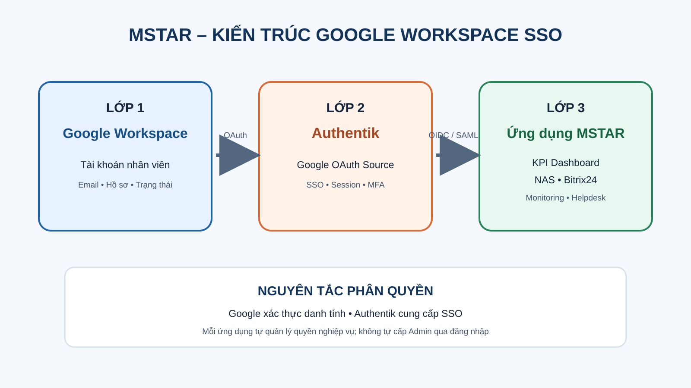
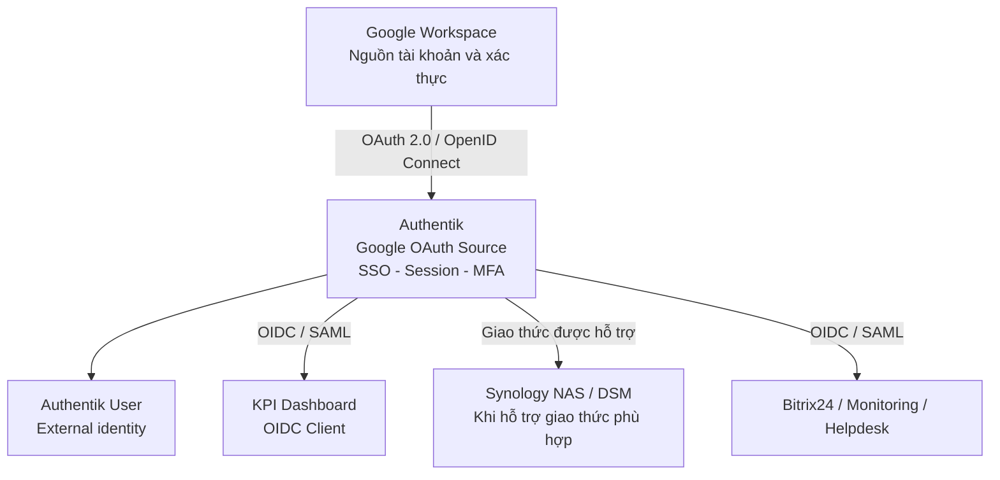
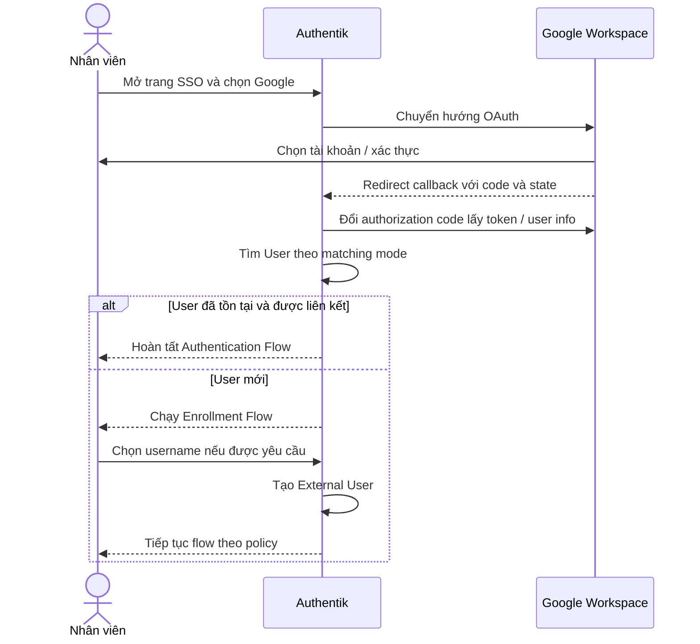
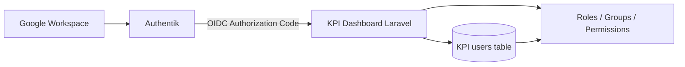

# TÍCH HỢP GOOGLE WORKSPACE VỚI AUTHENTIK – SSO IDENTITY SOURCE

- Ngày ghi nhận: 11/11/2026
- Phiên bản: 1.0
- Trạng thái: Google OAuth Source đã xác thực và tạo External User thành công.
- Phạm vi: Kết nối tài khoản Google Workspace với Authentik làm nguồn đăng nhập; chuẩn bị nền tảng SSO cho ứng dụng nội bộ MSTAR.

> Tài liệu ghi nhận thao tác thực tế và kết quả đã quan sát trong quá trình triển khai. Các bước đồng bộ Google Directory/Groups và kết nối OIDC với KPI Dashboard chưa được thực hiện trong giai đoạn này.



## 1. Mục tiêu và kiến trúc

Mục tiêu là để nhân viên sử dụng tài khoản Google Workspace hiện có để đăng nhập Authentik. Authentik đóng vai trò Identity Provider/Broker cho các ứng dụng nội bộ. Ứng dụng vẫn tự quản lý quyền nghiệp vụ của mình.



### 1.1 Vai trò từng lớp

| Lớp | Thành phần | Trách nhiệm |
|---|---|---|
| 1 – Identity Source | Google Workspace | Quản lý tài khoản Google và xác thực ban đầu; cung cấp hồ sơ người dùng theo scope được cấp |
| 2 – SSO / IdP | Authentik | Tiếp nhận đăng nhập từ Google, quản lý phiên SSO và phát hành token/assertion cho ứng dụng |
| 3 – Applications | KPI Dashboard, NAS, Bitrix24, Monitoring… | Tiếp nhận danh tính từ Authentik và tự áp dụng quyền nghiệp vụ |

**Phân biệt Authentication và Authorization:** đăng nhập Google thành công chỉ chứng minh danh tính. Việc được dùng chức năng nào trong KPI/NAS/Bitrix phải do ứng dụng hoặc chính sách phân quyền tương ứng quyết định. Không cấp quyền Admin chỉ vì người dùng đăng nhập bằng Google.

### 1.2 Phạm vi hiện tại và phần chưa có

- Đã làm: một Google OAuth Source trong Authentik; người dùng Google thử nghiệm được chuyển về callback và tạo thành External User.
- Chưa làm: đồng bộ toàn bộ danh bạ Google Workspace, đơn vị/phòng ban, Google Groups; tự động provisioning/deprovisioning; OIDC Provider cho KPI Dashboard.
- Google OAuth Source không đồng nghĩa với đồng bộ đầy đủ Google Directory. Nếu cần quản lý vòng đời và nhóm tập trung, phải thiết kế thêm quy trình Google Admin SDK/Directory API hoặc cơ chế provisioning phù hợp.

## 2. Thông tin môi trường liên quan

| Thành phần | Giá trị |
|---|---|
| Authentik hostname | `mstarcorp` |
| Authentik LAN IP | `192.168.1.156` |
| Public SSO URL | `https://sso.mstarcorp.vn/` |
| Authentik HTTP bind ghi nhận | `192.168.1.156:9000` |
| Authentik HTTPS bind ghi nhận | `127.0.0.1:9443` |
| Authentik container version | `2026.8.5` |
| Google OAuth Source name | `Google Workspace MSTAR` |
| Source slug | `google` |
| Callback URI | `https://sso.mstarcorp.vn/source/oauth/callback/google/` |

URL công khai hoạt động tại thời điểm kiểm thử và hiển thị giao diện Authentik qua HTTPS. Cần tiếp tục quản lý chứng thư TLS, DNS, reverse proxy và firewall trong vận hành.

## 3. Chuẩn bị Google Cloud

### 3.1 Tạo project

1. Mở Google Cloud Console: https://console.cloud.google.com/
2. Tạo project, ví dụ `MSTAR-SSO`.
3. Chọn project này trước khi cấu hình OAuth.

### 3.2 Cấu hình Google Auth Platform

1. Mở Google Auth Platform.
2. Cấu hình Audience. Chọn **Internal** nếu tổ chức Google Workspace cho phép và mục tiêu là giới hạn ứng dụng cho người dùng trong cùng tổ chức MSTAR.
3. Hoàn thiện thông tin ứng dụng theo chính sách quản trị Google Workspace.

> Nếu không thấy lựa chọn Internal hoặc project không thuộc tổ chức Workspace phù hợp, cần kiểm tra lại organization và quyền quản trị Google Cloud. Không chuyển sang External chỉ để bỏ qua cấu hình tổ chức.

### 3.3 Tạo OAuth Client ID

1. Mở Clients/Credentials.
2. Chọn Create OAuth client ID.
3. Application type: **Web application**.
4. Đặt tên nhận diện, ví dụ `MSTAR Authentik`.
5. Cấu hình hai trường URL riêng biệt:

**Authorized JavaScript origins** – chỉ là origin, không kèm path. Có thể để trống khi không cần browser-side JavaScript OAuth; nếu khai báo thì dùng:

```text
https://sso.mstarcorp.vn
```

**Authorized redirect URIs** – URI callback đầy đủ:

```text
https://sso.mstarcorp.vn/source/oauth/callback/google/
```

Không nhập callback URL vào mục JavaScript origins. Google báo lỗi “Invalid origin: URIs must not contain a path or end with '/'” khi nhập URI có đường dẫn vào trường này.

### 3.4 Lưu thông tin OAuth

Sau khi Create, Google cung cấp:
- Client ID
- Client Secret

Lưu hai giá trị trong kho bí mật phù hợp. Không đưa Client Secret vào Git, ảnh chụp, tài liệu công khai hoặc ticket. Nếu secret đã lộ, rotate/recreate theo quy trình của Google Cloud.

## 4. Cấu hình Google OAuth Source trong Authentik

Đi tới Admin interface → **Directory → Federation and Social login** → New Source → Google OAuth Source. Tên menu có thể thay đổi nhẹ theo phiên bản.

### 4.1 Source identity

| Trường | Giá trị đề xuất | Ý nghĩa |
|---|---|---|
| Source Name | `Google Workspace MSTAR` | Tên hiển thị trong Authentik |
| Slug | `google` | Định danh URL; phải thống nhất với callback |
| Enabled | ON | Kích hoạt Source |
| Promoted | ON nếu muốn nút Source nổi bật | Điều khiển cách Source hiển thị trên trang login; không thay thế cấu hình Identification Stage |
| User matching mode | `Link users on unique identifier` | Ghép danh tính theo định danh duy nhất thay vì chỉ dựa vào email |
| Group matching mode | Giữ `Link users on unique identifier` ở giai đoạn đầu | Không triển khai ghép nhóm theo tên khi chưa có kế hoạch group provisioning |
| User path | Giữ mặc định `goauthentik.io/sources/%(slug)s` | Đường dẫn phân loại User được tạo từ Source |

**Lưu ý về liên kết User:** lựa chọn unique identifier giúp tránh tự động liên kết tài khoản chỉ vì email trùng. Khi đã tồn tại User nội bộ, cần có quy trình xác minh và liên kết tài khoản có kiểm soát. Không giả định rằng chọn chế độ này sẽ tự ghép user cũ bằng email.

### 4.2 OAuth protocol settings

| Trường | Cấu hình |
|---|---|
| Consumer Key | Google OAuth Client ID |
| Consumer Secret | Google OAuth Client Secret |
| Scopes | Để mặc định/để trống nếu cấu hình mặc định của Source đã yêu cầu scope đăng nhập cần thiết; không ghi đè scope nếu chưa xác minh |
| OAuth Attribute Mapping | Giai đoạn đầu giữ mặc định; chỉ bổ sung mapping khi có yêu cầu dữ liệu cụ thể |
| Group Property Mappings | Để trống khi chưa đồng bộ Google Groups |

Không xin quyền Gmail, Drive hoặc các API khác nếu mục tiêu chỉ là đăng nhập. Chỉ thêm scope cần thiết theo tài liệu và yêu cầu thực tế.

### 4.3 Flow settings

| Trường | Giá trị đã cấu hình/giữ mặc định | Vai trò |
|---|---|---|
| Authentication Flow | `default-source-authentication` | Xử lý xác thực cho User đã có |
| Enrollment Flow | `default-source-enrollment` | Xử lý đăng ký khi User đăng nhập lần đầu |
| Policy engine mode | `ANY` | Logic kết hợp các Policy; cần thiết kế policy cụ thể trước khi thay đổi |

Trong thử nghiệm, lần đăng nhập đầu tiên từng báo **“Source is not configured for enrollment”**. Sau khi cấu hình Enrollment Flow `default-source-enrollment`, quy trình chuyển tiếp sang màn hình chọn username.

### 4.4 Thêm Source vào Login Flow

Để nút Google hiển thị trên trang đăng nhập:

1. Mở **Flows and Stages → Flows**.
2. Chọn `default-authentication-flow`.
3. Mở tab Stage Bindings và xác định Identification Stage đang được flow sử dụng (thường là `default-authentication-identification`).
4. Chỉnh Identification Stage, thêm `Google Workspace MSTAR` vào danh sách Sources được phép hiển thị/chọn.
5. Lưu và tải lại trang login.

Promoted chỉ ảnh hưởng cách trình bày Source; nếu Source chưa được gắn vào Identification Stage thì nút có thể không xuất hiện.

## 5. Quy trình đăng nhập và Enrollment



### 5.1 Diễn biến đã quan sát

1. Truy cập trang SSO: `https://sso.mstarcorp.vn/`.
2. Chọn Google Workspace MSTAR.
3. Google xác thực tài khoản và chuyển trình duyệt về:
   `https://sso.mstarcorp.vn/source/oauth/callback/google/`.
4. Authentik xử lý callback và Enrollment Flow.
5. Màn hình mặc định yêu cầu chọn username.
6. Sau khi hoàn tất Enrollment, User xuất hiện trong Directory → Users với Type = External.

### 5.2 Các lỗi đã gặp và cách xử lý

| Hiện tượng | Nguyên nhân/nhận định | Hướng xử lý |
|---|---|---|
| Mở trực tiếp callback báo Not Found | Callback không phải trang login để truy cập thủ công; có thể chưa có OAuth transaction hoặc Source/slug chưa khớp | Bắt đầu từ trang login, kiểm tra Source Enabled, slug và URI |
| Google Cloud báo Invalid origin | Callback path bị nhập vào JavaScript origins | Origin chỉ nhập `https://sso.mstarcorp.vn` hoặc để trống; callback đầy đủ đặt ở Redirect URIs |
| Trang login chưa có nút Google | Source chưa hiển thị trong Identification Stage hoặc chưa Promoted | Bật Promoted nếu mong muốn và thêm Source vào Identification Stage |
| Bad Request – Source is not configured for enrollment | Source thiếu Enrollment Flow | Chọn `default-source-enrollment`, lưu lại |
| Sau Google quay lại trang chọn username | Enrollment Flow đang chạy cho User mới | Đây là bước Enrollment bình thường |
| Permission denied – Interface can only be accessed by internal users | External User không được phép truy cập giao diện người dùng nội bộ của Authentik | Không đổi User thành Internal/Staff chỉ để bỏ lỗi; kiểm tra mục tiêu ứng dụng. Nhân viên sẽ dùng SSO vào các ứng dụng được cấp quyền, không cần quyền quản trị Authentik |

### 5.3 Kết quả kiểm chứng

Ảnh chụp và thao tác trong phiên triển khai xác nhận:
- Google OAuth redirect đã quay lại callback Authentik.
- Enrollment Flow đã chạy sau khi được cấu hình.
- Một tài khoản thử nghiệm Google Workspace đã xuất hiện trong **Directory → Users**.
- User có Type = **External**, trạng thái Active = **Yes**.
- Tài khoản quản trị `akadmin` vẫn là Internal; tài khoản service của Outpost vẫn là service account.

**Kết luận:** Google OAuth Source đã kết nối thành công và tạo External User. Điều này chưa chứng minh OIDC login đến KPI Dashboard đã hoạt động; OIDC Provider/Application cho KPI chưa được tạo trong giai đoạn này.

## 6. Mô hình User và phân quyền

| Thành phần | Vai trò |
|---|---|
| Google Workspace account | Tài khoản nguồn do tổ chức quản lý |
| Authentik External User | Hồ sơ danh tính được tạo/liên kết trong Authentik từ nguồn ngoài |
| Authentik Internal/Superuser | Tài khoản quản trị Authentik; không cấp cho nhân viên phổ thông |
| KPI Dashboard User | Hồ sơ người dùng nghiệp vụ hiện có trong KPI |
| Application roles/groups | Quyền nghiệp vụ được ứng dụng quản lý hoặc nhận từ cơ chế provisioning đã kiểm soát |

Không cần tạo mật khẩu Authentik giống mật khẩu Google. Google thực hiện xác thực; Authentik duy trì hồ sơ External User và phiên SSO. Không đặt cùng một username không đồng nghĩa với phải có thêm một tài khoản/mật khẩu do người dùng tự quản.

### 6.1 Chính sách đề xuất trước production

- Giới hạn đăng nhập ở Google Workspace của tổ chức; kiểm tra Audience Internal và chính sách domain.
- Không bật tự đăng ký rộng rãi nếu không kiểm soát được đối tượng được phép.
- Không cấp quyền Admin/Staff Authentik cho mọi External User.
- Cấp quyền ứng dụng theo nguyên tắc least privilege.
- Xây dựng quy trình Joiner/Mover/Leaver và kiểm tra khả năng thu hồi session.
- Định nghĩa nguồn có thẩm quyền cho từng thuộc tính (email, mã nhân viên, phòng ban, trạng thái làm việc).
- Thiết kế liên kết User hiện có một cách có kiểm soát; không tự ghép chỉ theo email nếu chưa xác minh.

## 7. Kiểm thử nghiệm thu

| STT | Hạng mục | Kết quả/Trạng thái |
|---:|---|---|
| 1 | Truy cập `https://sso.mstarcorp.vn/` qua HTTPS | Đã quan sát hoạt động |
| 2 | Google OAuth Client có Redirect URI chính xác | Đã cấu hình |
| 3 | Google Source Enabled | Đã cấu hình |
| 4 | Google OAuth callback quay về Authentik | Đã quan sát |
| 5 | Enrollment Flow xử lý User mới | Đã quan sát |
| 6 | External User xuất hiện trong Directory → Users | Đã xác nhận |
| 7 | Đồng bộ Google Directory/Groups | Chưa triển khai |
| 8 | OIDC Provider/Application cho KPI | Chưa triển khai |
| 9 | Đăng nhập SSO từ KPI Dashboard | Chưa triển khai |
| 10 | Thu hồi session khi khóa tài khoản Google | Chưa kiểm thử |

## 8. Giai đoạn tiếp theo – Kết nối KPI Dashboard bằng OIDC

Kiến trúc mục tiêu:



Các việc cần làm:

1. Kiểm tra các route login/callback hiện có trong Laravel.
2. Chốt Redirect URI thực tế, không dùng URI giả định.
3. Tạo OAuth2/OpenID Provider trong Authentik.
4. Tạo Application gắn với Provider.
5. Cấu hình Laravel OIDC client, kiểm tra state, nonce, issuer, audience, chữ ký token và HTTPS.
6. Liên kết OIDC subject `sub` với tài khoản KPI đã tồn tại; cân nhắc thêm cột `authentik_sub` với unique index sau khi rà soát migration và dữ liệu.
7. Giữ nguyên cơ chế phân quyền nội bộ và phạm vi dữ liệu khách hàng của KPI.
8. Duy trì local login như phương án dự phòng trong giai đoạn thử nghiệm.

Mapping dự kiến (cần xác nhận claim thực tế từ token/userinfo trước khi triển khai):

| OIDC claim | Trường KPI | Lưu ý |
|---|---|---|
| `sub` | `authentik_sub` | Định danh ổn định trong issuer; không tự suy diễn từ email |
| `email` | `email` | Dùng kiểm tra liên kết, không nhất thiết là khóa duy nhất |
| `name` | `name` | Tên hiển thị |
| `employee_id` | `employee_code` | Chỉ có nếu nguồn dữ liệu cung cấp và mapping đã cấu hình |
| `department` | `department` / `department_id` | Cần bảng đối chiếu tổ chức |
| `groups` | Bảng mapping quyền | Không cấp Admin trực tiếp từ claim nếu chưa có whitelist |

## 9. Bảo mật và lưu ý vận hành

- Client Secret Google là thông tin nhạy cảm; lưu trong secret manager hoặc cấu hình được bảo vệ.
- Không ghi token, authorization code, state, secret vào log hoặc tài liệu.
- URL callback chỉ dùng như một phần của OAuth transaction; không mở thủ công để kiểm thử.
- Không chia sẻ ảnh chụp có URL callback chứa `code` hoặc `state`; các giá trị này có vòng đời ngắn nhưng vẫn nhạy cảm.
- Bảo đảm thời gian hệ thống đồng bộ NTP để hạn chế lỗi kiểm tra token.
- Theo dõi log Authentik khi gặp lỗi callback; kiểm tra reverse proxy chuyển tiếp scheme/host chính xác.
- Backup Authentik database và cấu hình trước khi thay đổi lớn; kiểm tra quy trình restore.
- Trước production cần thử khóa tài khoản Google, thu hồi session/token và kiểm tra hành vi với ứng dụng đang có session.

## 10. Tài liệu tham khảo

- Authentik documentation: https://docs.goauthentik.io/
- Authentik Sources: https://docs.goauthentik.io/add-secure-apps/sources/
- Google OAuth 2.0 for Web Server Applications: https://developers.google.com/identity/protocols/oauth2/web-server
- Google Auth Platform: https://console.cloud.google.com/auth/

---

**Lịch sử cập nhật**
- 11/11/2026 – Ghi nhận cấu hình Google OAuth Source, Enrollment Flow và kết quả External User trên Authentik.
