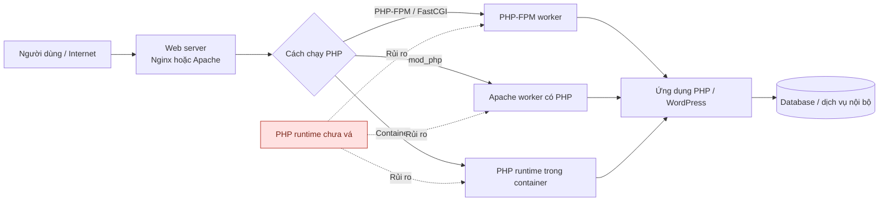
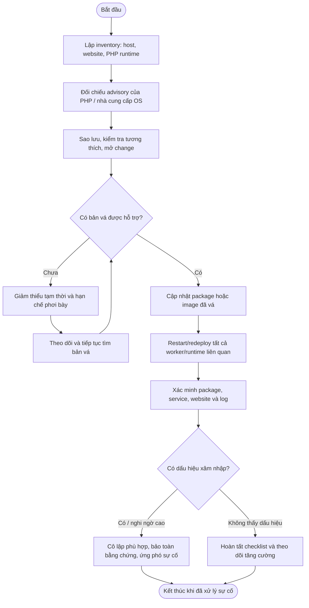
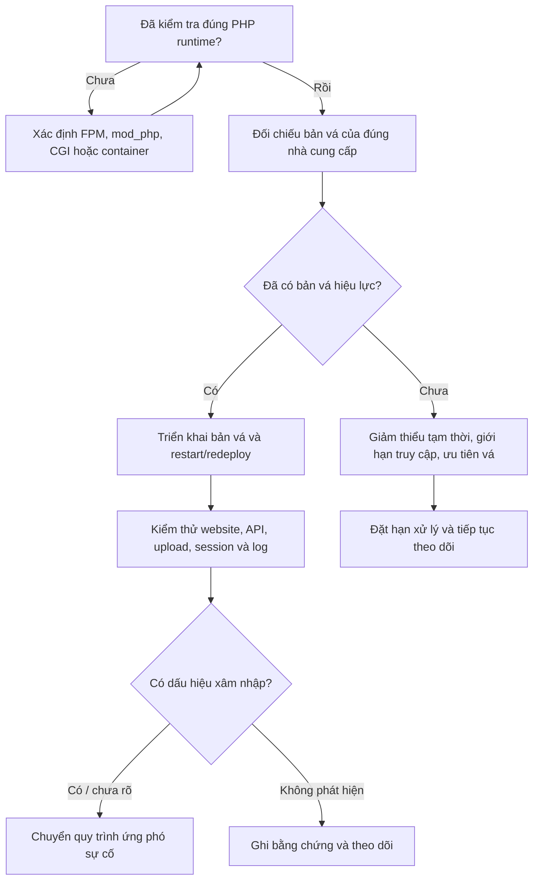

# PHP2Shell — Giải thích, rà soát, khắc phục và phòng chống

> **Loại tài liệu:** Runbook vận hành bảo mật  
> **Ngôn ngữ:** Tiếng Việt  
> **Ngày biên soạn/cập nhật:** 26/10/2026  
> **Đối tượng:** Quản trị viên Linux, DevOps, quản trị web, đội an toàn thông tin  
> **Phạm vi:** Máy chủ PHP trên Ubuntu/Debian, PHP-FPM, Apache mod_php, CGI/FastCGI và môi trường container.  
>
> **Cảnh báo:** Đây là hướng dẫn vận hành. Thực hiện trên hệ thống production cần có cửa sổ bảo trì, backup đã kiểm tra và phương án rollback. Không coi một lần kiểm tra phiên bản CLI là bằng chứng duy nhất cho thấy website đã được vá.

---

## Minh họa trực quan

Các sơ đồ dưới đây dùng Mermaid, được GitHub render trực tiếp trong trang Markdown nên không cần tải ảnh riêng. Sơ đồ mô tả kiến trúc và quy trình vận hành ở mức khái quát; không phải bằng chứng kiểm thử khai thác.

### Hình 1 — Luồng request và vị trí cần rà soát



**Ý nghĩa:** cần xác định PHP runtime thực sự xử lý request. Cập nhật PHP CLI trên host không nhất thiết cập nhật PHP-FPM, Apache mod_php hoặc runtime nằm trong container.

### Hình 2 — Quy trình xử lý PHP2Shell



### Hình 3 — Cây quyết định sau khi kiểm tra máy chủ



---

## 1. Tóm tắt điều hành

PHP2Shell là tên gọi được sử dụng cho hai lỗ hổng nghiêm trọng trong PHP, được công bố ngày 21/10/2026:

- **CVE-2026-109618** — lỗi xử lý tình trạng hết bộ nhớ (out-of-memory, OOM) trong quá trình phân tích request, có thể dẫn tới thực thi mã từ xa.
- **CVE-2026-109619** — lỗi sử dụng trạng thái nội bộ đã giải phóng (use-after-free/stale state) trong vòng đời xử lý request, có thể dẫn tới thực thi mã từ xa.

Theo thông báo chính thức PHP và cơ quan an ninh mạng Singapore, hai lỗ hổng có điểm **CVSS v4.0 9.2/10**. Kẻ tấn công từ xa không cần xác thực có thể khai thác máy chủ PHP bị ảnh hưởng. Các triển khai phục vụ request web cần được rà soát, đặc biệt máy chủ công khai Internet và Apache mod_php.

**Biện pháp khắc phục đầy đủ là cài bản vá của PHP hoặc bản vá do nhà cung cấp hệ điều hành phân phối.** Cấu hình giảm thiểu chỉ giảm một số đường khai thác, không thay thế bản vá.

## 2. Nguồn chính thức và tình trạng phiên bản

### 2.1 Nguồn bắt buộc cần kiểm tra trước khi thay đổi

1. PHP Security Advisory và hướng dẫn giảm thiểu:  
   https://www.php.net/archive/2026.php#2026-10-21-5
2. PHP Security Advisory cho CVE-2026-109618:  
   https://github.com/php/php-src/security/advisories/GHSA-w8hw-w9fx-j79w
3. PHP Security Advisory cho CVE-2026-109619:  
   https://github.com/php/php-src/security/advisories/GHSA-6wmf-4rv5-p3rp
4. Singapore Cyber Security Agency (CSA):  
   https://www.csa.gov.sg/alerts-and-advisories/alerts/al-2026-151/
5. Red Hat Security Advisory:  
   https://access.redhat.com/security/vulnerabilities/RHSB-2026-013
6. Plesk — phiên bản PHP đi kèm Plesk và cập nhật:  
   https://support.plesk.com/hc/en-us/articles/44397729587351-Vulnerability-CVE-2026-109618-and-CVE-2026-109619-PHP2Shell-Remote-code-execution-in-PHP-shipped-with-Plesk
7. Hướng dẫn CSA giám sát dấu hiệu xâm nhập (PDF liên kết trong cảnh báo CSA):  
   https://www.csa.gov.sg/alerts-and-advisories/alerts/al-2026-151/

### 2.3 Cập nhật advisory liên quan sau ngày công bố

Ngày 23/10/2026, PHP đăng thông báo bổ sung về một đường RCE hiếm gặp liên quan đến session upload progress trong tổ hợp cấu hình đặc biệt; PHP cho biết sẽ phát hành advisory riêng ở bản bugfix kế tiếp. Vì vậy, tại thời điểm thực hiện runbook, hãy kiểm tra thông báo mới nhất trên PHP.net, cân nhắc đặt `session.upload_progress.enabled=0` nếu phù hợp và kiểm thử tác động đến ứng dụng. Thông báo bổ sung này **không thay thế yêu cầu cập nhật bản vá cho CVE-2026-109618 và CVE-2026-109619**.

Nguồn chính thức: https://www.php.net/archive/2026.php

### 2.2 Phiên bản upstream đã sửa trong đợt công bố ban đầu

| Nhánh PHP | Phiên bản upstream đã vá |
|---|---:|
| PHP 8.5 | 8.5.12 |
| PHP 8.4 | 8.4.27 |
| PHP 8.3 | 8.3.36 |
| PHP 8.2 | 8.2.35 |

Đây là phiên bản upstream được nêu trong thông báo phát hành ban đầu ngày 21/10/2026, không phải cam kết rằng chúng là bản mới nhất tại thời điểm đọc tài liệu. Hãy kiểm tra thông báo PHP hiện hành trước khi thay đổi.

**Lưu ý về Ubuntu/Debian/Red Hat:** Nhà cung cấp có thể backport bản vá vào gói mà số phiên bản upstream hiển thị không giống bảng trên. Đánh giá trạng thái vá dựa trên advisory và phiên bản gói của đúng bản phân phối, không chỉ so sánh chuỗi `php -v`. PHP 8.1 trở xuống không còn được dự án PHP hỗ trợ upstream; một số nhà cung cấp có thể cung cấp bản vá backport. Nếu không có bản vá được hỗ trợ, lập kế hoạch nâng cấp sang nhánh được hỗ trợ.

---

## 3. Hiểu lỗ hổng ở mức vận hành

### 3.1 CVE-2026-109618 — OOM/request parsing

Trong một đường xử lý lỗi bộ nhớ, trạng thái nội bộ khi phân tích request có thể chưa được khởi tạo đầy đủ nhưng phần dọn dẹp lại xử lý trạng thái đó như hợp lệ. Trong điều kiện khai thác phù hợp, lỗi bộ nhớ này có thể dẫn đến thực thi mã.

### 3.2 CVE-2026-109619 — stale state/use-after-free

Trạng thái nội bộ gắn với một request có thể còn sót lại sau khi bộ nhớ tương ứng đã được giải phóng. Một lần xử lý request tiếp theo trong cùng worker có thể sử dụng trạng thái không còn hợp lệ trước khi được khởi tạo lại.

### 3.3 Tác động tiềm tàng

Nếu khai thác thành công, kẻ tấn công có thể thực thi mã với quyền của tiến trình PHP/web server. Tác động thực tế phụ thuộc quyền filesystem, quyền truy cập dữ liệu, cấu hình dịch vụ, mạng nội bộ và mức cô lập của máy chủ.

Hậu quả có thể bao gồm đọc/sửa dữ liệu mà tài khoản dịch vụ được phép truy cập, tạo tệp mã độc, chạy tiến trình trái phép, dò tìm thông tin xác thực và tìm đường di chuyển sang hệ thống khác.

### 3.4 Những môi trường cần rà soát

- Apache với `mod_php`.
- Nginx hoặc Apache chuyển request sang PHP-FPM.
- `php-cgi`/FastCGI.
- FrankenPHP, LiteSpeed và các máy chủ khác sử dụng PHP để phục vụ request web.
- Container Docker/Kubernetes có PHP runtime.
- PHP được đóng gói cùng control panel như Plesk hoặc bộ cài của nhà cung cấp.
- Máy chủ có ứng dụng của bên thứ ba cài PHP dù website chính không được viết bằng PHP.

---

## 4. Quy trình ứng phó tổng quan

Thực hiện theo thứ tự:

1. **Lập danh sách tài sản:** máy chủ, website, phiên bản PHP, nguồn cài đặt, kiểu xử lý request, owner.
2. **Ưu tiên rủi ro:** hệ thống Internet-facing và Apache mod_php trước; hệ thống chưa hỗ trợ bản vá cần biện pháp giảm thiểu/giới hạn truy cập ngay.
3. **Chuẩn bị thay đổi:** backup, cửa sổ bảo trì, người phê duyệt, kế hoạch rollback.
4. **Cài bản vá phù hợp:** dùng đúng nguồn package đang quản lý hệ thống; không thêm repository không tin cậy tùy tiện.
5. **Khởi động lại mọi worker/process PHP liên quan:** để bảo đảm tiến trình cũ không tiếp tục phục vụ request.
6. **Xác minh:** binary, package, PHP-FPM/Apache, website thực tế, log ứng dụng và kiểm thử chức năng.
7. **Rà soát xâm nhập:** bản vá không chứng minh rằng hệ thống chưa bị khai thác trước đó.
8. **Ghi nhận bằng chứng:** thời gian, lệnh, phiên bản trước/sau, dịch vụ restart, người thực hiện, kết quả kiểm thử và ticket thay đổi.

Nếu có dấu hiệu xâm nhập, chuyển sang quy trình ứng phó sự cố ở mục 11. Không chỉ vá rồi coi sự cố đã được giải quyết.

---

## 5. Bước 1 — Xác định hệ điều hành, PHP và nguồn cài đặt

Chạy trên máy chủ bằng tài khoản quản trị có sudo.

### 5.1 Thông tin hệ điều hành

```bash
cat /etc/os-release
uname -a
date -Is
```

### 5.2 Kiểm tra PHP CLI

```bash
command -v php || true
php -v 2>&1 || true
php --ini 2>&1 || true
```

Các lệnh trên chỉ mô tả **PHP CLI**, có thể khác phiên bản website đang sử dụng.

### 5.3 Liệt kê các binary PHP

```bash
type -a php 2>/dev/null || true
ls -l /usr/bin/php* /usr/local/bin/php* 2>/dev/null || true
```

### 5.4 Kiểm tra package trên Debian/Ubuntu

```bash
dpkg -l | grep -E '^(ii|hi)[[:space:]]+php|php[0-9].*(fpm|cli|apache)' || true
apt-cache policy php php-cli php-fpm php8.2-fpm php8.3-fpm php8.4-fpm 2>/dev/null
```

Không phải tất cả tên gói trên đều có mặt. Thay các ví dụ `php8.x` bằng nhánh thực tế trên máy chủ.

### 5.5 Kiểm tra service và process

```bash
systemctl list-units --type=service --all | grep -Ei 'php.*fpm|apache2|httpd|nginx|lsws|litespeed' || true
ps -ef | grep -E '[p]hp-fpm|[p]hp-cgi|[a]pache2|[h]ttpd|[n]ginx|[l]shttpd' || true
sudo ss -lntp
```

### 5.6 Kiểm tra phiên bản package/container

Nếu dùng Docker:

```bash
docker ps --format 'table {{.Names}}\t{{.Image}}\t{{.Ports}}'
```

Với từng container PHP, kiểm tra image tag/digest, Dockerfile/base image và lịch cập nhật. `php -v` chạy trên host không xác minh được PHP bên trong container.

### 5.7 Xác minh phiên bản PHP mà website thực sự chạy

Ưu tiên:
- Xem cấu hình virtual host của web server và socket/service PHP-FPM được ánh xạ.
- Dùng công cụ quản trị của hosting/control panel.
- Dùng endpoint kiểm tra nội bộ chỉ cho phép localhost/IP quản trị và xóa ngay sau khi sử dụng.

**Không tạo một trang `phpinfo()` công khai trên Internet.** Endpoint kiểm tra có thể để lộ đường dẫn, module, biến môi trường và thông tin cấu hình. Khi kết thúc, xác nhận endpoint tạm đã được xóa.

---

## 6. Bước 2 — Chuẩn bị trước khi cập nhật

### 6.1 Ghi lại trạng thái hiện tại

```bash
date -Is
php -v 2>&1 || true
systemctl --no-pager --full status apache2 2>/dev/null || true
systemctl --no-pager --full status nginx 2>/dev/null || true
systemctl --no-pager --full status php8.2-fpm 2>/dev/null || true
```

Thay `php8.2-fpm` bằng service hiện hữu.

### 6.2 Sao lưu

- Backup database bằng phương thức phù hợp với DB đang dùng.
- Backup mã nguồn, upload/media, cấu hình web server, PHP và file deploy.
- Kiểm tra backup đọc được; nếu dịch vụ quan trọng, thử restore vào môi trường riêng.
- Không lưu bản backup chứa secrets tại thư mục web công khai hoặc đẩy lên Git.
- Ghi lại phiên bản package và danh sách package sẽ thay đổi.

### 6.3 Kiểm tra tương thích

- Kiểm tra yêu cầu PHP của ứng dụng/CMS/plugin.
- Nếu dùng nhiều nhánh PHP, xác định website nào gắn với nhánh nào.
- Xem danh sách package sẽ nâng cấp trước khi xác nhận.
- Với production quan trọng, thử trong staging trước.

### 6.4 Mở cửa sổ thay đổi

Thông báo ảnh hưởng dự kiến, người phụ trách, thời điểm, cách kiểm tra website và điều kiện rollback. Cập nhật package có thể cần reload/restart service và có thể ảnh hưởng các request đang chạy.

---

## 6.5. Nguyên tắc cập nhật để giảm tối đa nguy cơ ảnh hưởng hệ thống đang chạy

> **Không có thao tác cập nhật nào được bảo đảm tuyệt đối không ảnh hưởng.** Mục tiêu là giới hạn phạm vi thay đổi, phát hiện sớm lỗi tương thích và có phương án khôi phục đã kiểm chứng.

### A. Phân biệt vá bảo mật với nâng cấp hệ điều hành

- **Ưu tiên 1:** Cài bản vá bảo mật được nhà cung cấp hỗ trợ cho đúng bản Ubuntu/Debian/OS và nhánh PHP đang sử dụng, nếu bản vá đó đáp ứng advisory.
- **Ưu tiên 2:** Nếu không có bản vá phù hợp hoặc nhánh PHP đã hết hỗ trợ, đánh giá nâng cấp nhánh PHP/nguồn cung cấp PHP có hỗ trợ bảo mật; phải kiểm tra tương thích ứng dụng và thư viện.
- **Ưu tiên 3:** Chỉ nâng cấp major release của hệ điều hành khi có yêu cầu vòng đời/hỗ trợ hoặc là phương án được nhà cung cấp khuyến nghị và đã có kế hoạch migration riêng.
- Không chạy `do-release-upgrade`, `apt full-upgrade` hoặc `dist-upgrade` một cách máy móc chỉ để xử lý một CVE PHP.
- Không thêm PPA/repository bên thứ ba hoặc tải package thủ công để ép lên một số phiên bản mà chưa đánh giá nguồn gốc, dependency và khả năng hỗ trợ.

**Lưu ý:** bản vá ở cấp package vẫn có thể cập nhật thư viện phụ thuộc, thay đổi ABI hoặc yêu cầu restart service. “Chỉ cập nhật PHP” không đồng nghĩa “chỉ một package thay đổi”.

### B. Quy trình thay đổi an toàn cho production

1. **Lập baseline:** ghi OS/release, package PHP và extension, nguồn repository, service, cấu hình, phiên bản ứng dụng, trạng thái website và log lỗi hiện tại.
2. **Xác định đúng runtime:** phân biệt PHP CLI, PHP-FPM, Apache mod_php, PHP trong control panel và PHP trong container. Không cập nhật một runtime rồi bỏ sót runtime khác.
3. **Đọc advisory của nhà cung cấp:** xác nhận package/release đã được vá; không chỉ so sánh kết quả `php -v` với số phiên bản upstream.
4. **Sao lưu và xác minh khôi phục:** backup code, cấu hình, dữ liệu và các file upload theo chính sách; với máy ảo/container, chuẩn bị snapshot/image hoặc artifact cũ. Với database đang ghi, snapshot phải nhất quán theo hướng dẫn nền tảng; snapshot ổ đĩa đơn lẻ không phải lúc nào cũng là backup DB hợp lệ.
5. **Mô phỏng transaction APT:** chạy `apt update`, sau đó dùng `apt-get -s` để xem trước package sẽ cài/nâng cấp/gỡ bỏ. Đọc kỹ mọi dependency, kernel, web server, thư viện hệ thống và package không liên quan PHP. Nếu có gỡ package ngoài dự kiến, thay đổi diện rộng hoặc xung đột dependency, **dừng và điều tra**, không xác nhận cập nhật.
6. **Kiểm thử ngoài production:** ưu tiên staging được dựng gần với production, dùng cùng OS/repository, PHP extension, cấu hình và artifact ứng dụng. Kiểm thử chức năng trọng yếu, cron/queue, upload/import, session, kết nối DB và tích hợp bên ngoài.
7. **Phê duyệt thay đổi:** ghi rõ phạm vi package, thời gian, người chịu trách nhiệm, kiểm thử, điều kiện dừng, phương án rollback và người có quyền quyết định.
8. **Triển khai theo phạm vi nhỏ nhất:** cập nhật package đã xác định và cần thiết theo advisory; nếu hệ thống có nhiều node, triển khai canary/rolling từng node khi kiến trúc cho phép. Không áp dụng rolling update nếu ứng dụng hoặc DB không hỗ trợ.
9. **Xác minh ngay sau cập nhật:** kiểm tra package/runtime, trạng thái service, log, health check và chức năng nghiệp vụ. Theo dõi tăng cường sau khi đưa vào hoạt động.
10. **Đóng change hoặc rollback:** chỉ đóng khi đạt cả yêu cầu bảo mật và nghiệp vụ. Nếu lỗi vượt ngưỡng đã định, dừng rollout, giảm phạm vi ảnh hưởng và thực hiện phương án khôi phục đã được kiểm chứng.

### C. Xem trước thay đổi trên Ubuntu/Debian

Sau khi cập nhật metadata:

```bash
sudo apt update
sudo apt-get -s upgrade
```

Lệnh mô phỏng `apt-get -s upgrade` cho thấy phạm vi cập nhật tổng quát, nhưng **không tự chứng minh rằng tất cả thay đổi đều an toàn**. Đọc danh sách package sẽ thay đổi, package bị giữ lại và package bị gỡ bỏ.

Nếu muốn giới hạn vào các package PHP đang có, trước hết lập danh sách package PHP thực tế:

```bash
dpkg-query -W -f='${binary:Package}\t${Version}\n' 'php*' 2>/dev/null
```

Sau đó chọn đúng tên package đã cài và được nhà cung cấp xác nhận cần cập nhật. Ví dụ minh họa — phải thay bằng package thực tế trên máy:

```bash
sudo apt-get -s install --only-upgrade php8.2-cli php8.2-fpm php8.2-common
```

Chỉ khi mô phỏng cho thấy thay đổi phù hợp, đã đánh giá dependency và được phê duyệt mới thực hiện lệnh thật tương ứng. Tên package ví dụ không phải danh sách dùng chung cho mọi hệ thống; cần xem xét các extension/runtime khác đang cài. Tùy dependency và repository, ngay cả thao tác giới hạn package cũng có thể nâng cấp thêm thư viện phụ thuộc.

Không dùng `-y` để bỏ qua bước xem xét trên production. Nếu cần cập nhật các bản vá bảo mật khác của OS, thực hiện theo quy trình patch management của tổ chức, không trộn với một lần thay đổi PHP chưa được đánh giá.

### D. Quy tắc rollback

- Xác định trước **điều kiện rollback**: health check thất bại, HTTP 5xx tăng, chức năng trọng yếu lỗi, service không khởi động hoặc lỗi tương thích vượt ngưỡng.
- Ưu tiên khôi phục bằng image/release đã biết tốt hoặc snapshot nhất quán đã kiểm thử, theo runbook của nền tảng.
- Không mặc định rằng chạy `apt install package=old-version` là đủ: phiên bản cũ có thể không còn trong repository, dependency đã thay đổi và hạ cấp package có thể không an toàn.
- Khôi phục snapshot toàn máy có thể làm mất dữ liệu phát sinh sau thời điểm snapshot; phải đánh giá tính nhất quán và kế hoạch phục hồi dữ liệu trước khi thực hiện.
- **Không quay lại runtime dễ bị khai thác như giải pháp lâu dài.** Nếu rollback là cần thiết để khôi phục dịch vụ, phải áp dụng biện pháp giảm thiểu đã được phê duyệt, giới hạn phơi bày, ghi nhận người chấp nhận rủi ro và đặt thời hạn khắc phục.
- Với container, lưu image digest trước triển khai và có thể quay lại artifact trước đó theo quy trình deployment; nhưng không rollback về image có lỗ hổng mà không có kiểm soát rủi ro.

### E. Khi không có staging hoặc không thể trì hoãn bản vá critical

Với lỗ hổng RCE nghiêm trọng trên hệ thống Internet-facing, không được để thử nghiệm trở thành lý do trì hoãn vô thời hạn. Người phụ trách cần đánh giá mức phơi bày, biện pháp giảm thiểu tạm thời, khả năng cô lập/giới hạn truy cập và thời gian bảo trì khẩn cấp. Nếu buộc phải triển khai trực tiếp production, cần phê duyệt khẩn cấp, backup đã xác minh, phạm vi thay đổi nhỏ nhất, kiểm tra sau cập nhật và người trực xử lý rollback. Ghi rõ rủi ro còn lại nếu chưa thể vá.

---

## 7. Bước 3 — Khắc phục trên Ubuntu/Debian dùng package hệ điều hành

> Phần này chỉ phù hợp khi PHP được quản lý bởi APT. Nếu dùng PPA bên thứ ba, Ondřej Surý PPA, aaPanel, Plesk, build thủ công hoặc container, hãy dùng công cụ của đúng nhà cung cấp và đọc advisory của họ. Không trộn nhiều nguồn package để chạy theo một con số phiên bản.

### 7.1 Làm mới metadata

```bash
sudo apt update
```

Nếu lệnh lỗi, giải quyết lỗi repository/DNS/proxy trước. Không tiếp tục khi package index không được cập nhật đáng tin cậy.

### 7.2 Kiểm tra bản vá của nhà cung cấp

Kiểm tra phiên bản ứng viên và nguồn package cho đúng nhánh đang chạy:

```bash
apt-cache policy php-cli php-fpm php8.2-cli php8.2-fpm
```

Đổi `8.2` theo nhánh thực tế. Đối chiếu Ubuntu Security Notices hoặc Debian Security Tracker tương ứng với bản phân phối và release đang dùng. Đừng áp đặt số phiên bản upstream lên gói có backport.

Nguồn:
- Ubuntu Security: https://ubuntu.com/security
- Ubuntu CVE Tracker: https://ubuntu.com/security/cves
- Debian Security Tracker: https://security-tracker.debian.org/

### 7.3 Xem trước thay đổi

```bash
sudo apt-get -s upgrade
```

Đọc danh sách cài/nâng cấp/gỡ bỏ. Nếu có thay đổi lớn hoặc gỡ package không mong đợi, dừng lại để điều tra.

### 7.4 Thực hiện cập nhật có kiểm soát

**Không mặc định chạy `sudo apt upgrade` để xử lý riêng lỗ hổng PHP.** Lệnh này có thể cập nhật nhiều package của hệ điều hành cùng lúc, kéo theo thay đổi thư viện, dịch vụ hoặc yêu cầu restart. Hãy áp dụng quy trình ở mục 6.5 và chỉ thực hiện sau khi đã xem trước transaction.

Nếu advisory xác nhận bản vá nằm trong các package PHP hiện có, chọn đúng package/runtime đã cài và mô phỏng trước. Ví dụ minh họa — thay tên package theo inventory thực tế:

```bash
sudo apt-get -s install --only-upgrade php8.2-cli php8.2-fpm php8.2-common
```

Đọc toàn bộ kết quả mô phỏng. Nếu có gỡ package, thay đổi ngoài phạm vi dự kiến, dependency xung đột hoặc chưa hiểu tác động, **dừng lại** và chuyển cho quản trị viên phụ trách. Nếu mô phỏng hợp lý, đã có backup/rollback, kiểm thử và phê duyệt, thực hiện lệnh tương ứng bằng cách bỏ `-s`.

Danh sách package trên chỉ là ví dụ, không dùng nguyên trạng cho mọi máy chủ. Phải bao phủ đúng runtime và extension có liên quan; package phụ thuộc vẫn có thể cần thay đổi. Nếu nhà cung cấp yêu cầu cập nhật thêm package hệ điều hành để nhận bản vá hoặc bảo đảm an toàn, xử lý theo một change OS patching riêng đã được đánh giá, thay vì gộp thay đổi rộng vào lần xử lý PHP mà chưa kiểm thử.

Không chạy `apt full-upgrade`, `dist-upgrade` hoặc nâng cấp major release OS một cách máy móc trên production.

### 7.5 Nếu hệ thống vẫn chưa có bản vá

- Xác minh đúng Ubuntu/Debian release và kho package.
- Kiểm tra advisory của nhà cung cấp, trạng thái phát hành và hướng dẫn backport.
- Với hệ thống Internet-facing, áp dụng giảm thiểu tại mục 8 và cân nhắc tạm ngừng dịch vụ công khai nếu không thể kiểm soát rủi ro.
- Không cài binary ngẫu nhiên từ website bên thứ ba.
- Nếu nhánh PHP đã hết hỗ trợ, lên kế hoạch chuyển sang nhánh được hỗ trợ hoặc nhà cung cấp có hỗ trợ bảo mật.

---

## 8. Bước 4 — Giảm thiểu tạm thời nếu chưa thể vá

**Các biện pháp dưới đây không phải bản vá hoàn chỉnh.** Chỉ áp dụng khi thật sự cần trong khoảng thời gian chờ cập nhật; theo dõi tương thích và gỡ bỏ khi không còn cần thiết theo advisory chính thức.

### 8.1 Tắt Session Upload Progress

PHP đề nghị tạm đặt:

```ini
session.upload_progress.enabled = 0
```

Cấu hình này giảm rủi ro cho các đường khai thác cụ thể liên quan CVE-2026-109619; không ngăn mọi biến thể khai thác.

Chọn cấu hình được nạp **trước khi xử lý request**, ví dụ file cấu hình PHP toàn cục hoặc cấu hình PHP-FPM pool/Apache phù hợp. Không dựa vào `ini_set()` trong ứng dụng hoặc `.user.ini` để bảo vệ giai đoạn trước khi mã ứng dụng được chạy.

Xác định file cấu hình thực sự:
```bash
php --ini
```
Lưu ý lệnh này phản ánh CLI. Với FPM, kiểm tra cấu hình service/pool và đường dẫn cấu hình của đúng binary.

Sau thay đổi, restart mọi worker PHP liên quan như mục 9. Kiểm tra ứng dụng có phụ thuộc tính năng upload progress hay không.

### 8.2 Giảm nguy cơ OOM và giới hạn request

Theo advisory upstream cho CVE-2026-109618, nếu chưa thể cập nhật ngay, biện pháp cấu hình được nêu là đặt `memory_limit=-1` theo cách ứng dụng không thể ghi đè (ví dụ cấu hình quản trị phù hợp của Apache hoặc PHP-FPM), đồng thời kiểm tra không có cấu hình theo pool/directory/ứng dụng đặt lại giới hạn hữu hạn. **Đây chỉ là biện pháp giảm thiểu tạm thời, không phải bản vá hoàn chỉnh**: lỗi cấp phát bộ nhớ ở tầng hệ điều hành vẫn có thể dẫn đến đường xử lý dễ bị ảnh hưởng. Tắt giới hạn bộ nhớ PHP cũng có thể làm tăng rủi ro cạn tài nguyên và ảnh hưởng tính sẵn sàng, vì vậy không áp dụng đại trà mà chưa đánh giá tải, giới hạn hệ điều hành/container, mức phơi bày và được người phụ trách phê duyệt.

Ngoài ra, giữ `post_max_size` ở mức thấp nhất đáp ứng nhu cầu thực tế và bảo đảm `upload_max_filesize` thấp hơn `post_max_size`. Không sao chép giá trị mẫu như `8M` hoặc `32M` lên production nếu chưa kiểm tra yêu cầu upload/import của ứng dụng.

Ở lớp reverse proxy/web server, cân nhắc giới hạn kích thước request **sau giải mã**, số phần multipart, số header trong từng phần, số trường đầu vào và độ sâu lồng nhau. Nếu ứng dụng không sử dụng upload/multipart, có thể chặn loại request đó ở frontend trước khi đến PHP. Các giới hạn phải phù hợp với luồng nghiệp vụ và không được coi là thay thế bản vá.

Không dùng `RLIMIT_AS` hoặc `RLIMIT_DATA` như biện pháp thay thế `memory_limit`; các giới hạn này có thể khiến `mmap()` thất bại và kích hoạt đường xử lý OOM liên quan. Giới hạn cgroup/container có thể là hàng rào bảo vệ tính sẵn sàng nhưng cũng không phải bản vá hoàn chỉnh.

**Trước khi thay đổi:** thử trên staging, kiểm tra các luồng upload/import/API, theo dõi mức dùng RAM và xác định cách khôi phục cấu hình. Không chỉnh các giới hạn trên production nếu chưa biết ứng dụng phụ thuộc vào chúng như thế nào.

### 8.3 Các biện pháp giảm thiểu khác theo PHP upstream

- Với PHP 8.5 chưa thể cập nhật, advisory cho CVE-2026-109619 nêu `fatal_error_backtraces=0` để loại bỏ producer được dùng trong trường hợp RCE đã xác nhận. Biện pháp này không bao phủ mọi trạng thái nội bộ/extension.
- Với đường khai thác liên quan vòng đời session của CVE-2026-109619, đặt `session.upload_progress.enabled=0` trong cấu hình quản trị có hiệu lực trước khi xử lý request, rồi restart mọi worker liên quan. Đây không phải biện pháp bao phủ mọi đường khai thác.
- PHP phát hành thông báo bổ sung ngày 23/10/2026 đề nghị tạm đặt `session.upload_progress.enabled=0` cho đến bản bugfix release kế tiếp để giảm một đường RCE hiếm gặp khác, chỉ xuất hiện với tổ hợp cấu hình `session.serialize_handler` và `ini_set()` đặc biệt. Kiểm tra advisory chính thức mới nhất trước khi quyết định thời điểm gỡ cấu hình này.
- Loại bỏ cấu hình INI không hợp lệ, xung đột hoặc đã deprecated có thể phát sinh diagnostic trước khi request initialization hoàn tất. Ưu tiên cấu hình startup được quản trị tập trung; không dựa vào `ini_set()` hoặc `.user.ini` cho biện pháp cần có hiệu lực trước khi request được khởi tạo.
- Sửa các fatal error/timeout mà người dùng bên ngoài có thể kích hoạt, đặc biệt trong callback, upload/import, error handling, shutdown và cleanup. Bật log phù hợp trong đợt audit; việc không thấy lỗi trong log không chứng minh hệ thống an toàn.
- Có thể cân nhắc `pm.max_requests=1` như biện pháp giảm thời gian sống của worker nếu phù hợp hiệu năng, nhưng không coi việc recycle worker là bản vá hay giải pháp đầy đủ.

Tham khảo nguyên văn hướng dẫn cập nhật tại: https://www.php.net/archive/2026.php#2026-10-21-5

---

## 9. Bước 5 — Khởi động lại đúng service để worker mới sử dụng cấu hình/bản vá

Trước tiên liệt kê service:

```bash
systemctl list-units --type=service --all | grep -Ei 'php.*fpm|apache2|httpd|nginx|lsws|litespeed'
```

### 9.1 PHP-FPM trên Ubuntu/Debian

Tên service thay đổi theo nhánh PHP và cách cài. Ví dụ **chỉ dùng nếu service đó thật sự tồn tại**:

```bash
sudo systemctl restart php8.2-fpm
sudo systemctl --no-pager --full status php8.2-fpm
```

Nếu đang dùng nhiều phiên bản FPM, khởi động lại **tất cả service/pool có thể phục vụ website bị ảnh hưởng**.

### 9.2 Apache

Nếu dùng Apache `mod_php`, PHP thường chạy bên trong tiến trình Apache; cần áp dụng bản vá package PHP/Apache phù hợp và restart/reload theo hướng dẫn package. Ví dụ:

```bash
sudo apache2ctl configtest
sudo systemctl restart apache2
sudo systemctl --no-pager --full status apache2
```

Nếu dùng Apache proxy tới PHP-FPM, phải xử lý cả đúng service PHP-FPM lẫn cấu hình Apache cần thiết.

### 9.3 Nginx + PHP-FPM

Nginx không tự chạy PHP; thông thường PHP-FPM mới là runtime. Sau khi xử lý PHP-FPM, kiểm tra và reload Nginx khi có thay đổi cấu hình Nginx:

```bash
sudo nginx -t
sudo systemctl reload nginx
```

Không reload/restart mù quáng. Kiểm tra cú pháp trước, theo dõi status và log sau. Với container, cần triển khai/recreate container từ image đã vá; restart container cũ không làm image bên trong được cập nhật.

---

## 10. Bước 6 — Xác minh sau khắc phục

### 10.1 Kiểm tra package và binary

```bash
php -v
dpkg -l | grep -E 'php.*(cli|fpm|apache|common)' || true
apt-cache policy php-cli php-fpm
```

Đối chiếu với advisory của đúng nhà cung cấp. Số phiên bản CLI đơn lẻ không đủ xác nhận các FPM pool hoặc container đã được vá.

### 10.2 Kiểm tra service

```bash
systemctl --failed
systemctl --no-pager --full status apache2 2>/dev/null || true
systemctl --no-pager --full status nginx 2>/dev/null || true
systemctl --no-pager --full status php8.2-fpm 2>/dev/null || true
```

Thay service ví dụ cho phù hợp với máy chủ.

### 10.3 Kiểm tra log

```bash
sudo journalctl --since '-30 minutes' --no-pager | grep -Ei 'php|fpm|apache|nginx|error|failed|segfault|oom' | tail -200
```

Đọc log của đúng service và application; lọc chung như trên chỉ là bước gợi ý, không thay thế kiểm tra log chuyên biệt.

### 10.4 Kiểm thử nghiệp vụ website

- Homepage và các URL quan trọng trả về kết quả như mong đợi.
- Đăng nhập, session và phân quyền hoạt động.
- Database access hoạt động.
- Upload/download/import hoạt động theo chính sách.
- API, cron, queue/worker và tác vụ nền liên quan hoạt động.
- Không có 5xx tăng bất thường hoặc lỗi PHP mới.
- TLS, reverse proxy và health checks bình thường.

### 10.5 Kiểm tra cấu hình giảm thiểu (nếu đã đặt)

Kiểm tra giá trị hiệu lực của đúng runtime FPM/Apache và đảm bảo mọi worker cũ đã được thay thế. Không chỉ kiểm tra CLI. Xóa endpoint kiểm thử tạm và không để lộ trang phpinfo công khai.

### 10.6 Điều kiện nghiệm thu

Chỉ đánh dấu **ĐÃ KHẮC PHỤC** khi có đủ:
- Bằng chứng package/runtime đã nhận bản vá từ nguồn được hỗ trợ.
- Các service và worker liên quan đã được restart/redeploy.
- Kiểm thử chức năng đạt.
- Log không có lỗi mới nghiêm trọng.
- Đã rà soát dấu hiệu xâm nhập hoặc mở ticket điều tra nếu có tín hiệu đáng ngờ.
- Đã lưu bằng chứng, thời gian, người xử lý và kết quả.

---

## 11. Bước 7 — Rà soát dấu hiệu bị xâm nhập

Bản vá chặn khai thác tiếp theo nhưng không xóa mã độc hay hoàn tác truy cập trái phép trước đó. Ưu tiên máy chủ Internet-facing, hệ thống chạy Apache mod_php và máy chủ PHP chưa vá trong thời gian dài.

### 11.1 Bảo toàn bằng chứng

Nếu thấy dấu hiệu xâm nhập:
1. Ghi lại thời điểm phát hiện, hostname, IP, tiến trình, kết nối và log liên quan.
2. Bảo toàn log và snapshot/bản sao dữ liệu theo quy trình IR của tổ chức.
3. Cân nhắc cô lập máy chủ khỏi Internet/mạng nội bộ theo kế hoạch sự cố; tránh làm mất bằng chứng.
4. Không xóa ngay các tệp nghi vấn hoặc kill hàng loạt tiến trình trước khi lưu bằng chứng, trừ khi cần hành động khẩn cấp để giới hạn thiệt hại.
5. Thông báo người phụ trách an toàn thông tin và đơn vị nghiệp vụ.

### 11.2 Kiểm tra tiến trình và kết nối đáng ngờ

```bash
ps auxf
sudo ss -tpn
sudo lsof -nP -i 2>/dev/null
```

Tìm tiến trình web/PHP khởi chạy shell, công cụ tải xuống hoặc tiến trình không thuộc baseline. Không kết luận xâm nhập chỉ dựa vào tên tiến trình; điều tra parent process, user, thời điểm khởi chạy, executable và network endpoints.

### 11.3 Kiểm tra file web mới/sửa đổi gần đây

Thay `/var/www` bằng document root thực tế:

```bash
sudo find /var/www -type f -mtime -7 -printf '%TY-%Tm-%Td %TH:%TM %u:%g %m %p\n' 2>/dev/null | sort
```

Đây chỉ là bước sàng lọc; deploy hợp lệ cũng tạo file mới, và kẻ tấn công có thể sửa timestamp. So sánh với artifact/release đã ký hoặc source-control đáng tin cậy. Rà soát file PHP mới, file ẩn, upload có nội dung thực thi, cron, systemd services và SSH authorized_keys.

### 11.4 Kiểm tra persistence và tài khoản

```bash
sudo crontab -l 2>/dev/null
sudo ls -la /etc/cron.d /etc/cron.daily /etc/cron.hourly
sudo systemctl list-unit-files --state=enabled
getent passwd
sudo find /home /root -name authorized_keys -type f -ls 2>/dev/null
```

Kiểm tra từng dấu hiệu bất thường dựa trên baseline; output hợp lệ của lệnh không tự chứng minh máy chủ sạch.

### 11.5 Kiểm tra log web và PHP

Vị trí log thay đổi theo hệ điều hành và cấu hình. Các đường dẫn thường gặp trên Ubuntu/Debian:

- `/var/log/nginx/access.log`
- `/var/log/nginx/error.log`
- `/var/log/apache2/access.log`
- `/var/log/apache2/error.log`
- Log PHP-FPM được định nghĩa trong cấu hình FPM/pool.
- Journal systemd nếu service ghi vào journald.

Tìm request lỗi bất thường, POST/request có kích thước hoặc cấu trúc bất thường, chuỗi thời gian khớp với crash/restart, request lặp đi lặp lại và lỗi PHP đáng ngờ. Không dựa vào một mẫu IOC đơn lẻ; có thể không có log đầy đủ hoặc payload đã thay đổi.

### 11.6 Khi xác nhận hoặc nghi ngờ cao bị xâm nhập

- Coi máy chủ là có khả năng đã bị kiểm soát.
- Cô lập và điều tra theo quy trình IR; xem xét dựng lại từ image sạch thay vì tin rằng chỉ xóa file là đủ.
- Xoay vòng secrets có thể đã bị đọc: database credentials, API tokens, cloud keys, deployment keys và thông tin xác thực liên quan.
- Kiểm tra truy cập ngang sang database, backup, các máy chủ khác và hệ thống quản trị.
- Restore dữ liệu từ nguồn tin cậy sau khi xác định phạm vi và nguyên nhân.
- Theo dõi sau khắc phục và lập báo cáo sự cố.

---

## 12. Phòng chống lâu dài

### 12.1 Quản lý bản vá

- Duy trì inventory tất cả máy chủ và container có PHP.
- Theo dõi PHP Security Advisory, advisory của OS, nhà cung cấp hosting và control panel.
- Có SLA vá theo mức độ nghiêm trọng; critical RCE trên hệ thống Internet-facing cần xử lý khẩn cấp.
- Thử nghiệm staging nhưng không để quá trình thử nghiệm trì hoãn vô thời hạn việc vá critical.
- Theo dõi EOL; lên kế hoạch nâng cấp khỏi nhánh không còn cập nhật bảo mật.

### 12.2 Giảm bề mặt tấn công

- Không public trực tiếp service nội bộ; chỉ mở port cần thiết.
- Đặt database/cache/management API trong private network.
- Dùng reverse proxy/WAF/rate limiting như lớp bổ sung, không coi là thay thế patch.
- Giới hạn upload/request size và độ phức tạp theo nhu cầu ứng dụng.
- Tách website và container theo đặc quyền tối thiểu.
- Không cho phép PHP ghi vào nơi chứa mã thực thi nếu không cần; upload phải được tách khỏi document root hoặc không được xử lý như mã.
- Không để secrets trong webroot, image, log hoặc Git.

### 12.3 Hardening PHP và hệ điều hành

- Chạy worker bằng user đặc quyền thấp.
- Giới hạn quyền đọc/ghi theo từng website.
- Giữ OS, web server, PHP extension và thư viện runtime được cập nhật.
- Bảo vệ SSH, bật firewall, MFA cho control panel và tài khoản quản trị.
- Quản lý secrets tập trung và xoay vòng khi có nghi ngờ.
- Ghi log tập trung, đồng bộ thời gian và bảo vệ log khỏi bị xóa/sửa.
- Backup ngoại tuyến/immutable và kiểm tra restore định kỳ.
- Tách staging/production, hạn chế quyền deploy và sử dụng artifact tin cậy.

### 12.4 Monitoring/alerting

Theo dõi:
- PHP-FPM/Apache worker crash/restart bất thường.
- OOM, memory pressure và tỷ lệ 5xx tăng đột biến.
- Tiến trình shell hoặc network connection do user web khởi chạy.
- File PHP mới hoặc thay đổi bất thường trong webroot.
- Thay đổi cron, systemd, tài khoản, SSH key.
- Outbound traffic lạ từ web server.
- Dấu hiệu truy cập các secrets hoặc hệ thống nội bộ.

Mọi cảnh báo phải được đối chiếu với lịch deploy và baseline để giảm false positive.

---

## 13. Checklist xử lý incident/change

### Trước khi triển khai
- [ ] Đã lập danh sách máy chủ, website, container và PHP runtime.
- [ ] Đã xác định nguồn package và advisory chính thức cho từng máy.
- [ ] Đã ưu tiên hệ thống Internet-facing.
- [ ] Đã backup và xác minh khả năng restore theo chính sách.
- [ ] Đã kiểm tra ứng dụng/plugin tương thích.
- [ ] Đã có cửa sổ bảo trì, người phê duyệt và phương án rollback.

### Triển khai
- [ ] Đã cài bản vá từ nguồn được hỗ trợ.
- [ ] Đã cập nhật/redeploy image/container nếu dùng container.
- [ ] Đã restart tất cả PHP workers/service bị ảnh hưởng.
- [ ] Nếu chưa thể vá, đã đánh giá biện pháp giảm thiểu và quyết định rủi ro có người phê duyệt.
- [ ] Không có repository/binary không tin cậy được thêm vào hệ thống.

### Sau triển khai
- [ ] Đã kiểm tra package/runtime và advisory tương ứng.
- [ ] Đã kiểm tra status service và log.
- [ ] Đã kiểm thử chức năng website/API/upload/login/session.
- [ ] Đã xác minh worker cũ đã được thay thế.
- [ ] Đã rà soát dấu hiệu xâm nhập.
- [ ] Đã ghi bằng chứng và kết quả vào ticket/change record.
- [ ] Đã thiết lập theo dõi tăng cường sau khi vá.

### Kết quả
- [ ] ĐÃ KHẮC PHỤC — có đủ bằng chứng vá và kiểm thử.
- [ ] GIẢM THIỂU TẠM THỜI — chưa có bản vá, còn rủi ro và có hạn xử lý.
- [ ] ĐANG ĐIỀU TRA SỰ CỐ — có dấu hiệu nghi ngờ/xác nhận xâm nhập.
- [ ] CHƯA XỬ LÝ — hệ thống vẫn có nguy cơ; cần ưu tiên khẩn cấp.

---

## 14. Các lỗi vận hành thường gặp cần tránh

1. **Chỉ chạy `php -v` rồi kết luận an toàn:** website có thể chạy FPM/container/nhánh PHP khác.
2. **Chỉ cập nhật WordPress/plugin:** lỗ hổng nằm ở PHP runtime, cần vá runtime.
3. **Chỉ tắt Session Upload Progress:** đây là giảm thiểu cho một đường khai thác, không phải sửa hoàn chỉnh.
4. **Chỉ restart mà không cập nhật binary/package:** worker mới vẫn có thể chạy bản vulnerable.
5. **Cập nhật nhầm repository/nhầm nhánh:** có thể gây downtime hoặc phụ thuộc không tương thích.
6. **Xem hệ thống đã sạch ngay sau khi vá:** bản vá không loại bỏ persistence hoặc secrets đã bị lộ.
7. **Để file phpinfo/debug endpoint tồn tại công khai:** có thể làm lộ thông tin nhạy cảm.
8. **Chỉ dựa vào WAF/firewall:** các lớp này giảm bề mặt tấn công nhưng không thay thế bản vá PHP.

---

## 15. Nhật ký triển khai mẫu

| Trường | Giá trị cần ghi |
|---|---|
| Ticket/change ID | |
| Hostname/IP | |
| Hệ điều hành/release | |
| Website/application | |
| PHP runtime (CLI/FPM/mod_php/container) | |
| Package/image trước cập nhật | |
| Advisory của nhà cung cấp | |
| Package/image sau cập nhật | |
| Service/worker được restart | |
| Kiểm thử chức năng | |
| Kết quả rà soát IOC/log | |
| Phát hiện sự cố? | Có / Không / Cần điều tra thêm |
| Người thực hiện/người xác nhận | |
| Thời gian bắt đầu/kết thúc | |
| Trạng thái cuối | Đã khắc phục / Giảm thiểu / Đang điều tra / Chưa xử lý |

---

## 16. Tài liệu tham khảo

- PHP News Archive — Security advisory và giảm thiểu: https://www.php.net/archive/2026.php#2026-10-21-5
- GHSA CVE-2026-109618: https://github.com/php/php-src/security/advisories/GHSA-w8hw-w9fx-j79w
- GHSA CVE-2026-109619: https://github.com/php/php-src/security/advisories/GHSA-6wmf-4rv5-p3rp
- Singapore Cyber Security Agency: https://www.csa.gov.sg/alerts-and-advisories/alerts/al-2026-151/
- Red Hat Security Advisory RHSB-2026-013: https://access.redhat.com/security/vulnerabilities/RHSB-2026-013
- Plesk security guidance: https://support.plesk.com/hc/en-us/articles/44397729587351-Vulnerability-CVE-2026-109618-and-CVE-2026-109619-PHP2Shell-Remote-code-execution-in-PHP-shipped-with-Plesk
- Ubuntu Security: https://ubuntu.com/security
- Debian Security Tracker: https://security-tracker.debian.org/

---

## 17. Tuyên bố phạm vi và bảo trì tài liệu

Tài liệu là runbook vận hành nhằm hỗ trợ xử lý, không thay thế advisory của nhà cung cấp hoặc quy trình ứng phó sự cố của tổ chức. Tình trạng bản vá thay đổi theo thời gian, bản phân phối và nguồn package. Trước mỗi lần triển khai, kiểm tra lại các liên kết chính thức, version/package fix và hướng dẫn riêng cho môi trường thực tế.

**Nguyên tắc chốt:** Vá PHP bằng nguồn cập nhật được hỗ trợ, thay thế tất cả worker/runtime bị ảnh hưởng, xác minh website thực tế và điều tra dấu hiệu xâm nhập. Không có một cấu hình giảm thiểu đơn lẻ nào thay thế được bản vá hoàn chỉnh.
