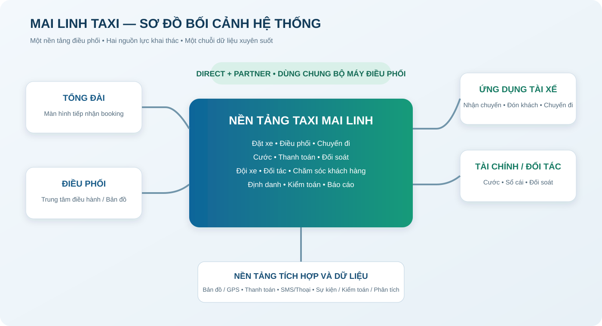

# 00 — TỔNG QUAN DÀNH CHO LÃNH ĐẠO

## 1. Tóm tắt

Xây dựng một nền tảng vận hành taxi thống nhất, bao phủ tiếp nhận yêu cầu, điều phối, theo dõi chuyến, tính cước, thanh toán, chăm sóc khách hàng và quản trị đối tác.

Phạm vi vận hành gồm:
- **DIRECT:** xe/tài xế Mai Linh quản lý trực tiếp.
- **PARTNER:** xe/tài xế hợp tác với Mai Linh.

Hai loại nguồn lực có thể cùng tham gia điều phối nếu đáp ứng điều kiện. Hợp đồng, trách nhiệm, doanh thu, công nợ và đối soát phải phân biệt theo mô hình.

## 2. Kết quả kỳ vọng

- Điều hành tập trung, theo dõi booking và phương tiện gần thời gian thực.
- Giảm sai sót khi tiếp nhận booking và chuẩn hóa dữ liệu địa chỉ.
- Truy vết đầy đủ vòng đời booking/trip và các lần đổi xe/tài xế.
- Đo hiệu suất theo chi nhánh, vùng, ca, kênh, loại dịch vụ và fleet type.
- Đối soát PARTNER dựa trên trip ledger và policy snapshot.
- Có quy trình xử lý ngoại lệ, sự cố và khiếu nại.

## 3. Phạm vi sản phẩm

| Ứng dụng | Người dùng | Mục đích |
|---|---|---|
| Call Center Web | Tổng đài | Tạo/quản lý booking |
| Dispatcher Web | Điều độ, giám sát | Dispatch, Control Tower, exception queue |
| Driver App | Tài xế | Nhận chuyến, điều hướng, cập nhật trạng thái |
| Customer App/Web (TBD) | Khách hàng | Tự đặt xe, theo dõi, thanh toán |
| Partner Portal (TBD) | Đối tác | Hồ sơ, hiệu suất, settlement |
| Admin Console | IT | IAM, role, cấu hình, tích hợp |
| Finance Workspace | Tài chính | Fare, payment, ledger, settlement |

## 4. System context

## 5. Nguyên tắc kiến trúc/nghiệp vụ

- API-first, least privilege, auditability, data minimization.
- State transition được kiểm soát phía server.
- Event tài chính append-only; điều chỉnh bằng record mới.
- GPS freshness tách biệt vehicle operational status.
- Idempotency cho lệnh tạo dữ liệu, driver events và payment webhooks.
- Policy có version và effective date.
- Booking, Trip, Fare, Ledger là các nguồn dữ liệu có liên kết rõ ràng.

## 6. Approval gates

| Gate | Điều kiện |
|---|---|
| G1 Business Scope | Owner xác nhận scope, thuật ngữ, DIRECT/PARTNER |
| G2 Process Baseline | Operations phê duyệt workflow, state và ngoại lệ |
| G3 Commercial Baseline | Business/Finance phê duyệt fare, payment, settlement |
| G4 UX Baseline | Người dùng đại diện duyệt prototype |
| G5 Technical Baseline | IT duyệt kiến trúc, API, NFR, security, DR |
| G6 Release Acceptance | QA/UAT, Operations, Finance, IT ký nghiệm thu |

Các quyết định chưa xác nhận nằm trong [Decision Register](./15-Decision-Register.md).
