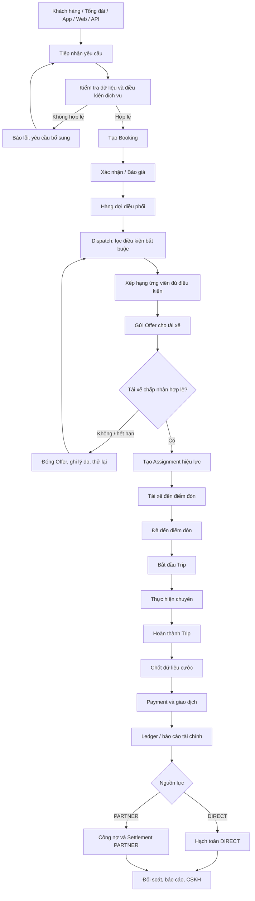
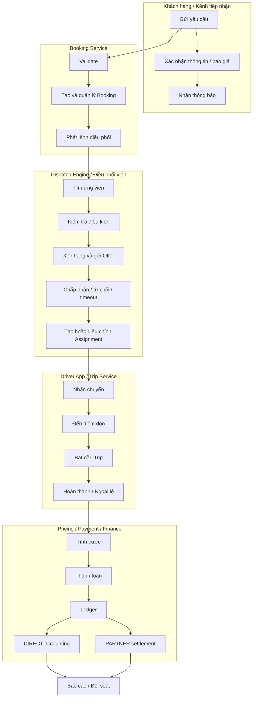

# 00A — THIẾT KẾ TỔNG THỂ VÀ LUỒNG VẬN HÀNH HỆ THỐNG TAXI MAI LINH

**Phiên bản:** 0.1-dự thảo  
**Trạng thái:** Tài liệu trục chính để rà soát trước khi phân rã Module  
**Phạm vi:** Một nền tảng điều phối thống nhất DIRECT + PARTNER

> Đây là bản thiết kế khung kết nối các đặc tả hiện có. Chưa thay thế phê duyệt nghiệp vụ, tài chính, pháp chế, kiến trúc và bảo mật.

## 1. Mục tiêu

Tài liệu này thống nhất:
1. Hệ thống tiếp nhận yêu cầu từ đâu.
2. Booking đi qua các bước nghiệp vụ nào.
3. Các vai trò và Module phối hợp ra sao.
4. Dữ liệu, trạng thái được chuyển giao thế nào.
5. Chuyến đi kết thúc được ghi nhận, thanh toán và quyết toán ra sao.

Đây là tài liệu đọc trước các đặc tả Module. Mọi thay đổi luồng phải đánh giá ảnh hưởng đến yêu cầu, UI, API, dữ liệu, kiểm thử và tài liệu liên quan.

## 2. Nguyên tắc bất biến

- Một nền tảng tiếp nhận và điều phối thống nhất.
- DIRECT và PARTNER là hai loại nguồn lực khai thác, không phải hai hệ thống đặt xe tách biệt.
- Kênh đặt xe (booking_channel) độc lập với loại đội xe (fleet_type).
- Booking là yêu cầu dịch vụ; Assignment là kết quả phân công; Trip là lần thực hiện chuyến. Không gộp ba khái niệm này.
- Một booking chỉ có tối đa một assignment đang hiệu lực tại một thời điểm.
- Chỉ nguồn xe vượt qua điều kiện bắt buộc mới được đưa vào danh sách ứng viên.
- Mọi chuyển trạng thái quan trọng phải lưu actor, thời gian máy chủ, nguồn phát sinh, lý do và mã tương quan.
- Lịch sử vận hành và bút toán tài chính không bị xóa/sửa để che lấp sai lệch; điều chỉnh phải có dấu vết.
- DIRECT/PARTNER dùng chung quy trình vận hành nhưng hợp đồng, doanh thu, công nợ, khoản khấu trừ và đối soát phải được phân loại, kiểm soát riêng.
- Chính sách chưa được phê duyệt phải giữ trạng thái TBD; không biến giả định thành cấu hình sản xuất.

## 3. Bản đồ năng lực toàn hệ thống

| Lớp | Nhóm năng lực | Module liên quan |
|---|---|---|
| Kênh tiếp nhận | App khách hàng, tổng đài, web, API, cổng đối tác | Customer, Booking, Integration |
| Quản trị nguồn lực | Tài xế, xe, đội xe, đối tác, điều kiện khai thác | Fleet Management, Partner Management |
| Điều hành chuyến | Booking, tìm xe, mời tài xế, phân công, chuyến đi | Booking, Dispatch, Driver App, Trip |
| Thương mại | Biểu giá, báo giá, phụ phí, thanh toán | Pricing, Payment |
| Tài chính | Sổ cái, doanh thu, công nợ, đối soát và chi trả | Finance, Settlement |
| Điều hành và hỗ trợ | Control Tower, CSKH, sự cố, thông báo | Control Tower, Customer Service, Notification |
| Nền tảng dùng chung | IAM, phân quyền, kiểm toán, báo cáo, tích hợp, giám sát | IAM, Audit, Reporting, Integration, Platform Operations |

## 4. Luồng vận hành đầu cuối chuẩn

### 4.1. Tiếp nhận và tạo Booking

**Đầu vào:** kênh tiếp nhận, thông tin liên hệ khách hàng, điểm đón, điểm đến/điểm dừng, loại dịch vụ, thời gian yêu cầu và điều kiện đặc biệt.

**Xử lý:**
1. Xác định kênh và người/tổ chức khởi tạo.
2. Chuẩn hóa địa chỉ, tọa độ; cho phép xác nhận vị trí đón.
3. Kiểm tra dữ liệu bắt buộc, vùng phục vụ và loại dịch vụ.
4. Phát hiện yêu cầu trùng theo quy tắc được duyệt.
5. Tạo booking với mã tra cứu và trạng thái hợp lệ.
6. Lưu lịch sử thay đổi và thông tin báo giá nếu có.

**Đầu ra:** booking_id, trạng thái booking, điểm đón/trả, báo giá hoặc lý do chưa thể báo giá.

### 4.2. Điều phối và phân công

1. Dispatch nhận booking đủ điều kiện.
2. Tạo dispatch run có mã riêng và phiên bản chính sách áp dụng.
3. Lấy danh sách tài xế/xe có thể khai thác.
4. Loại ứng viên không đạt điều kiện: trạng thái, giấy tờ, loại xe, vị trí, xung đột chuyến và điều kiện hợp đồng.
5. Xếp hạng ứng viên theo chính sách được phê duyệt.
6. Gửi lời mời có thời hạn; ghi nhận gửi, nhận, từ chối hoặc hết hạn.
7. Khi tài xế chấp nhận, kiểm tra nguyên tử booking, tài xế và xe vẫn đủ điều kiện.
8. Chỉ một kết quả phân công được phép thắng; các lời mời cạnh tranh phải đóng.
9. Nếu không có ứng viên hoặc hết lượt thử, giữ booking trong hàng đợi ngoại lệ; không tự ý hủy.

**Đầu ra:** assignment đang hiệu lực hoặc trạng thái ngoại lệ có lý do và lịch sử thử điều phối.

### 4.3. Thực hiện Trip

1. Tài xế nhận thông tin phân công.
2. Cập nhật trạng thái di chuyển đến điểm đón.
3. Ghi nhận đến điểm đón và bằng chứng theo chính sách.
4. Bắt đầu chuyến khi đủ điều kiện.
5. Ghi nhận các mốc hành trình và sự kiện phát sinh.
6. Hoàn thành chuyến hoặc chuyển sang luồng ngoại lệ: hủy, không có khách, sự cố, tranh chấp.
7. Máy chủ xác thực mọi chuyển trạng thái; ứng dụng không tự quyết định trạng thái có thẩm quyền.

**Đầu ra:** Trip đã hoàn thành hoặc trạng thái kết thúc/ngoại lệ có thể kiểm toán.

### 4.4. Cước, thanh toán và tài chính

1. Pricing tính cước dựa trên dữ liệu chuyến và phiên bản biểu giá có hiệu lực.
2. Lưu bản chụp đầu vào, phiên bản biểu giá và kết quả tính.
3. Payment ghi nhận phương thức, yêu cầu, phản hồi nhà cung cấp và trạng thái giao dịch.
4. Ledger ghi nhận bút toán theo quy tắc kế toán được phê duyệt.
5. Phân loại DIRECT/PARTNER theo assignment/trip đã xác thực, không suy luận từ kênh đặt xe.
6. Với PARTNER, tạo dữ liệu đối soát từ bản chụp hợp đồng/chính sách tại thời điểm phát sinh.
7. Duyệt, khóa batch và chi trả phải có phân quyền, bằng chứng và lịch sử điều chỉnh.

## 5. Swimlane theo vai trò và hệ thống

Sơ đồ thể hiện trách nhiệm logic, không khẳng định kiến trúc triển khai vật lý hay công nghệ cụ thể.

## 6. Chuỗi dữ liệu xuyên Module

| Thứ tự | Đối tượng dữ liệu | Module sở hữu | Liên kết chính |
|---:|---|---|---|
| 1 | Customer | Customer | customer_id |
| 2 | Booking | Booking | booking_id, customer_id |
| 3 | DispatchRun / Offer | Dispatch | dispatch_id, offer_id, booking_id |
| 4 | Assignment | Dispatch | assignment_id, booking_id, driver_id, vehicle_id, fleet_type |
| 5 | Trip / TripEvent | Trip | trip_id, assignment_id |
| 6 | FareQuote / FareResult | Pricing | quote_id, trip_id, tariff_version_id |
| 7 | PaymentTransaction | Payment | payment_id, trip_id, quote_id |
| 8 | LedgerEntry | Finance | ledger_entry_id, trip_id, payment_id |
| 9 | SettlementBatch / Line | Settlement | settlement_id, partner_id, ledger_entry_id |

Tên thực thể là định danh logic tham chiếu; kiểu dữ liệu, quan hệ vật lý và chuẩn đặt tên cuối cùng phải thống nhất trong ERD và từ điển dữ liệu.

## 7. Luồng ngoại lệ bắt buộc

| Mã | Tình huống | Hành vi tối thiểu | Đơn vị xử lý |
|---|---|---|---|
| EX-01 | Booking thiếu/sai dữ liệu | Không điều phối; chỉ rõ trường lỗi | Booking / Tổng đài |
| EX-02 | Không tìm thấy xe | Giữ booking, ghi phạm vi tìm, chuyển hàng đợi ngoại lệ | Dispatch |
| EX-03 | Tài xế từ chối/hết hạn | Đóng Offer, lưu lý do, thử lại | Dispatch |
| EX-04 | Hai tài xế cùng chấp nhận | Chỉ một assignment thành công nhờ kiểm tra nguyên tử | Dispatch |
| EX-05 | Tài xế/xe mất điều kiện sau phân công | Chặn thao tác không hợp lệ, đánh giá phân xe lại | Fleet / Dispatch |
| EX-06 | Khách hủy/đổi điểm đón | Kiểm tra trạng thái, chính sách, báo giá và Offer | Booking |
| EX-07 | Mất GPS/mất kết nối | Đánh dấu dữ liệu cũ/ngoại tuyến, có quy trình dự phòng | Driver App / Operations |
| EX-08 | Không có khách tại điểm đón | Ghi bằng chứng, thời gian chờ và xử lý theo chính sách | Trip |
| EX-09 | Sự cố an toàn/SOS | Tạo incident ưu tiên cao, lưu vị trí và người tiếp nhận | Control Tower |
| EX-10 | Thanh toán không rõ kết quả | Không ghi nhận thành công giả; đối soát nhà cung cấp | Payment / Finance |
| EX-11 | Tranh chấp cước | Giữ hồ sơ và bằng chứng; điều chỉnh có phê duyệt | CSKH / Finance |
| EX-12 | Sai lệch PARTNER | Tạo khoản điều chỉnh có liên kết, không sửa lịch sử đã khóa | Settlement |

## 8. State Machine cần thống nhất

Tài liệu 03 và 19 hiện còn khác nhau về một số tên trạng thái. Các chuỗi dưới đây là **đề xuất chuẩn hóa để rà soát**, chưa phải quyết định được phê duyệt.

| Đối tượng | Luồng trạng thái đề xuất | Kết thúc/ngoại lệ |
|---|---|---|
| Booking | DRAFT → REQUESTED → VALIDATED → READY_FOR_DISPATCH → DISPATCHING → ASSIGNED | CANCELLED, EXPIRED, UNFULFILLED, NEEDS_REVIEW |
| Offer | CREATED → SENT → ACCEPTED | DECLINED, EXPIRED, CANCELLED, SUPERSEDED |
| Assignment | PENDING → ACTIVE → COMPLETED | RELEASED, CANCELLED, REASSIGNED, FAILED |
| Trip | CREATED → DRIVER_EN_ROUTE → ARRIVED → IN_PROGRESS → COMPLETED | CANCELLED, NO_SHOW, INCIDENT, DISPUTED, NEEDS_REVIEW |
| Payment | INITIATED → PENDING → SUCCEEDED | FAILED, CANCELLED, REFUNDED, PARTIALLY_REFUNDED, RECONCILIATION_REQUIRED |

Booking, Offer, Assignment, Trip và Payment có vòng đời riêng. Không dùng một trường trạng thái chung để đại diện tất cả.

## 9. Phân định DIRECT và PARTNER

| Nội dung | Dùng chung | Phân biệt riêng |
|---|---|---|
| Tiếp nhận Booking | Có | Không theo kênh đặt |
| Dispatch Engine | Có | Chính sách ưu tiên chỉ áp dụng khi được duyệt |
| Driver App / Trip | Nền tảng và quy trình trạng thái chung | Hồ sơ nguồn lực và nghĩa vụ tương ứng |
| Pricing | Có thể dùng chung bộ máy | Biểu giá/điều kiện theo hợp đồng |
| Payment | Có thể dùng chung bộ máy giao dịch | Bên thụ hưởng và luồng tiền |
| Ledger | Cùng nguyên tắc kiểm toán | Đối tượng hạch toán phân loại |
| Contract | Không | DIRECT và PARTNER có căn cứ pháp lý khác nhau |
| Revenue / Receivable | Không gộp | Theo dõi riêng |
| Settlement | Không gộp | PARTNER có batch, line, duyệt và chi trả riêng |

Không xác định DIRECT/PARTNER chỉ bằng booking_channel, người tạo booking hoặc ứng dụng tiếp nhận.

## 10. Thứ tự phân rã Module và phát triển

| Thứ tự | Module/lát cắt | Kết quả cần đạt | Phụ thuộc chính |
|---:|---|---|---|
| 0 | Nền tảng dùng chung | IAM, audit, cấu hình, môi trường, CI/CD, giám sát | Quyết định kiến trúc |
| 1 | Customer + Fleet | Hồ sơ khách, tài xế, xe, đối tác và điều kiện khai thác | IAM, dữ liệu nguồn |
| 2 | Booking | Tạo/sửa/hủy, validation, báo giá tham chiếu, hàng đợi | Customer, Pricing |
| 3 | Dispatch | Candidate, eligibility, ranking, offer, assignment, manual dispatch | Fleet, Booking, realtime |
| 4 | Driver App + Trip | Nhận chuyến, trạng thái, GPS, sự kiện và ngoại lệ | IAM, Assignment |
| 5 | Pricing + Payment | Tính cước, thanh toán, hoàn tiền, đối soát giao dịch | Trip, provider |
| 6 | Finance + Settlement | Ledger, doanh thu, công nợ, đối soát DIRECT/PARTNER | Pricing, Payment, contract |
| 7 | Control Tower + CSKH | Giám sát, can thiệp, incident, hỗ trợ khách | Booking, Dispatch, Trip |
| 8 | Reporting + Integration | KPI, báo cáo, tích hợp và vận hành mở rộng | Dữ liệu chuẩn hóa |

Thứ tự là đề xuất theo phụ thuộc logic; kế hoạch phát hành thực tế cần được chủ sở hữu nghiệp vụ và kiến trúc phê duyệt.

## 11. Tiêu chuẩn hoàn thành một tính năng

Một tính năng chỉ sẵn sàng phát triển khi có:
- Mã tính năng, mục tiêu và người sở hữu nghiệp vụ.
- Luồng chính, luồng thay thế và luồng lỗi.
- Vai trò, quyền và phạm vi dữ liệu.
- Quy tắc nghiệp vụ, điều kiện đầu vào/đầu ra.
- UI/UX đủ trạng thái tải, trống, lỗi, mất kết nối, không đủ quyền và xung đột.
- API contract, event contract và idempotency nếu có.
- Mô hình dữ liệu, ràng buộc và migration.
- Nhật ký kiểm toán, bảo mật và NFR liên quan.
- Test case, acceptance criteria và bằng chứng nghiệm thu.
- Liên kết truy vết đến yêu cầu và Module phụ thuộc.

## 12. Quyết định còn mở

| Nhóm | Nội dung cần chốt | Chủ sở hữu đề xuất |
|---|---|---|
| Vận hành | DIRECT/PARTNER có ưu tiên hay điều kiện phân phối riêng không | Khối Vận hành |
| Dispatch | Bán kính, GPS freshness, timeout, retry, cách gửi Offer | Khối Vận hành |
| Booking | Đặt ngay/đặt trước, vùng phục vụ, quy tắc đổi/hủy | Vận hành / CSKH |
| Pricing | Biểu giá, phụ phí, làm tròn, thời điểm chốt cước | Tài chính / Vận hành |
| PARTNER | Tỷ lệ chia, khấu trừ, chu kỳ và điều kiện đối soát | Tài chính / Pháp chế |
| Payment | Tiền mặt/chuyển khoản/cổng thanh toán, hoàn tiền | Tài chính |
| Data | Lưu GPS, dữ liệu cá nhân, thời hạn lưu | Pháp chế / ATTT |
| NFR | Tải thiết kế, SLA, RPO/RTO, vùng triển khai | Kiến trúc / IT |
| Integration | Bản đồ, SMS/Voice, thanh toán, ERP | IT / Mua sắm |

Mọi quyết định phải ghi vào tài liệu 15 — Sổ đăng ký quyết định, có người phụ trách, hạn chốt và trạng thái phê duyệt.

## 13. Ma trận liên kết tài liệu hiện có

| Nội dung | Tài liệu chi tiết |
|---|---|
| Mục tiêu và phạm vi | 00, 01 |
| DIRECT/PARTNER | 02, 08 |
| Quy trình đầu cuối | 03 |
| Quy tắc và trạng thái | 04, 19, 21 |
| UI/UX và vai trò | 05, 06, 07, 22, 23 |
| Cước, Payment, Ledger, Settlement | 08, 20, 21 |
| Dữ liệu và API | 09, 10, 20, 21 |
| Kiến trúc và NFR | 11, 18, 24 |
| Kiểm thử và truy vết | 12, 16, 25 |
| Phát hành và vận hành | 13, 14, 26, 27, 30 |
| Quyết định và tích hợp | 15, 28, 29 |

## 14. Điều kiện thông qua thiết kế tổng thể

Chỉ chuyển sang phân rã chi tiết Module khi:
1. Chủ sở hữu nghiệp vụ xác nhận luồng Booking → Dispatch → Trip.
2. Vận hành xác nhận trạng thái và luồng ngoại lệ.
3. Tài chính/Pháp chế xác nhận nguyên tắc tách DIRECT/PARTNER.
4. Kiến trúc xác nhận ranh giới Module, quyền sở hữu dữ liệu và hợp đồng tích hợp.
5. Quyết định chưa chốt được ghi thành TBD có owner và thời hạn.
6. Có ma trận truy vết từ yêu cầu đến tính năng và kiểm thử.

**Kết luận:** 00A là trục điều hướng của bộ tài liệu. Các tài liệu 00–30 tiếp tục giữ vai trò đặc tả chuyên sâu. Sau khi rà soát và phê duyệt 00A, bước tiếp theo là chuẩn hóa State Machine và phân rã Module Booking thành các tính năng có thể giao phát triển.
