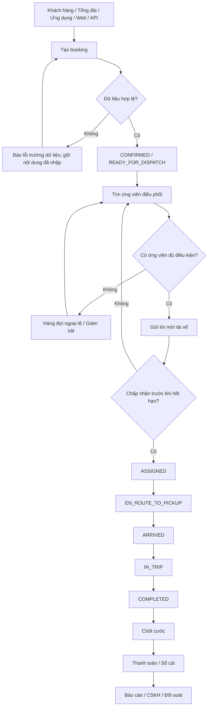
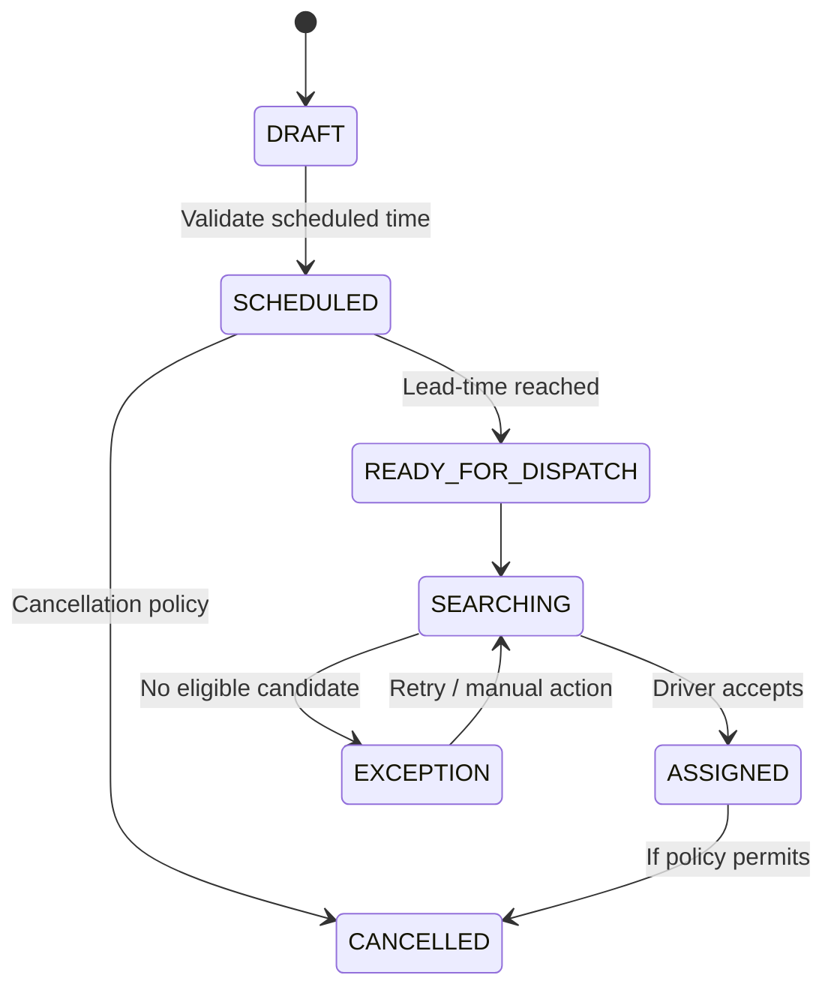
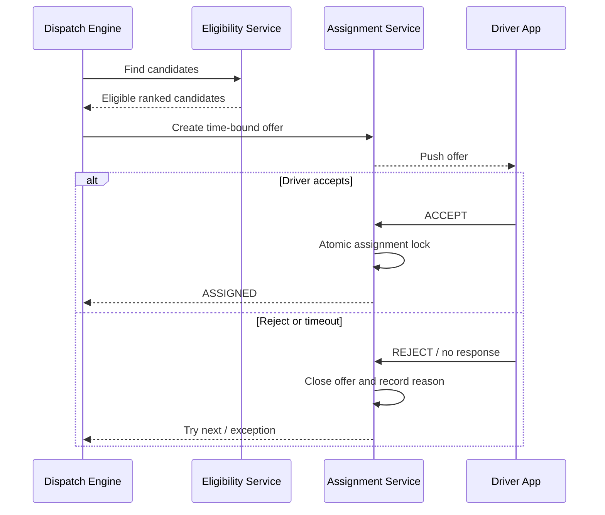
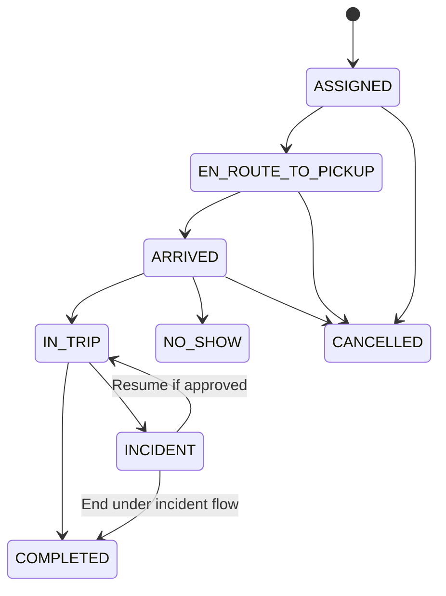
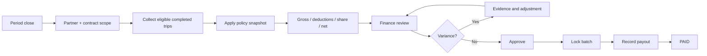

# 03 — CÁC QUY TRÌNH NGHIỆP VỤ ĐẦU CUỐI

## 1. Đặt xe → Điều phối → Chuyến đi → Thanh toán

## 2. Booking tức thời — Tổng đài

1. Agent nhận cuộc gọi, tìm khách theo số liên hệ, tạo hồ sơ tối thiểu nếu chưa có.
2. Nhập pickup; chọn geocoding suggestion; xác nhận pin và hướng dẫn đón.
3. Nhập destination và ordered stop list nếu được phép.
4. Chọn service/vehicle type, thời gian, hành khách, hành lý, ghi chú.
5. Validation và duplicate warning; xác nhận booking.
6. Booking vào dispatch queue.
7. No candidate/offer timeout: booking vẫn tồn tại và vào exception queue.

## 3. Booking đặt trước

Lead-time, cutoff và xử lý booking không có xe là TBD. Không tự hủy booking khi thiếu nguồn lực.

## 4. Vòng đời lời mời điều phối

Ranking weights, DIRECT/PARTNER priority, radius, timeout and retry count are TBD.

## 5. Máy trạng thái chuyến đi

Server validates every transition. Events store event ID, actor, server time, device time, source and reason.

## 6. Phân xe lại

- Check booking/trip state and dispatcher permission.
- Require reason (vehicle fault, driver reject, GPS issue, customer request, dispatcher action, other).
- Close prior assignment; never delete it.
- Re-evaluate eligibility and create next offer.
- Recalculate ETA and notify customer/operations according to policy.
- Preserve before/after and actor in audit.

## 7. Quy trình xử lý ngoại lệ

| Case | Evidence | Result |
|---|---|---|
| No-show | Arrival time, wait duration, reason/evidence | NO_SHOW + policy |
| Customer cancel | Actor, time, reason, state | CANCELLED |
| Driver cancel | Driver, reason, time | Re-dispatch/escalate |
| Vehicle failure | Vehicle, GPS, incident report | Reassign |
| SOS | Timestamp, location, trip, acknowledgement | High-severity incident |
| Payment exception | Provider ref, callback, status | Finance queue |

## 8. Đối soát đối tác

After LOCKED, use a linked adjustment batch instead of changing historical ledger lines.

## 9. Các sự kiện kiểm toán tối thiểu

BOOKING_CREATED/CONFIRMED/UPDATED/CANCELLED; DISPATCH_SEARCH_STARTED; DRIVER_OFFERED/ACCEPTED/REJECTED/EXPIRED; VEHICLE_ASSIGNED/REASSIGNED; DRIVER_EN_ROUTE/ARRIVED; TRIP_STARTED/COMPLETED/CANCELLED/NO_SHOW; FARE_CALCULATED; PAYMENT_INITIATED/SUCCEEDED/FAILED/REFUNDED; INCIDENT_CREATED/ACKNOWLEDGED/RESOLVED; SETTLEMENT_CALCULATED/APPROVED/LOCKED/PAID.
