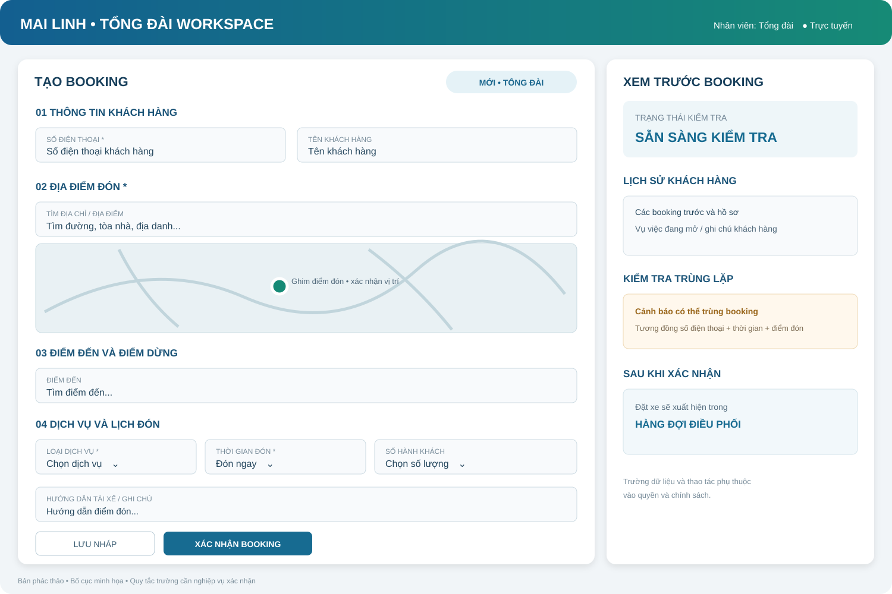
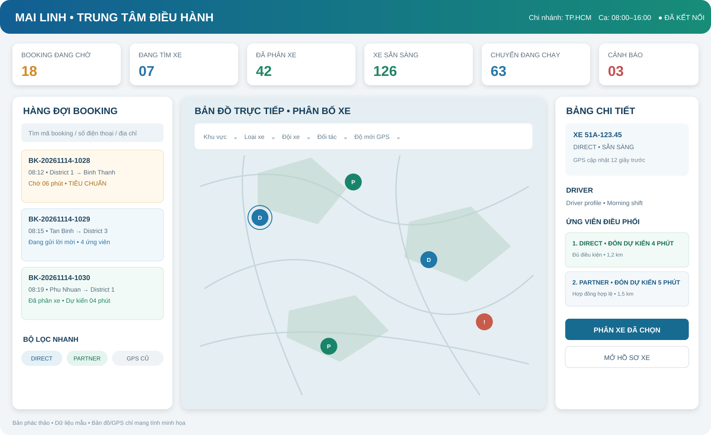
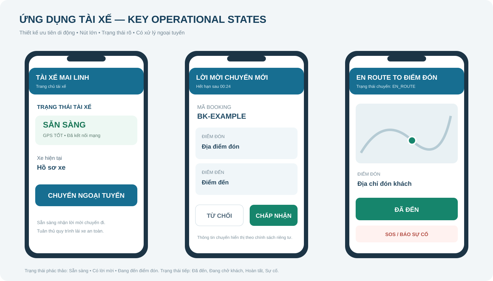

# 05 — ĐẶC TẢ GIAO DIỆN VÀ TRẢI NGHIỆM NGƯỜI DÙNG

## 1. Mục tiêu trải nghiệm người dùng

- Call Center: fast, accurate booking and location capture.
- Dispatcher: immediate visibility of pending demand, candidate supply and exceptions.
- Driver: minimal steps, readable status, safe interaction.
- Finance: transparent calculation, payment and reconciliation.
- Admin: role-based access and auditable configuration.

## 2. Screen inventory

| ID | Screen | Role | Priority |
|---|---|---|---|
| UI-01 | Call Center Booking Workspace | Call Center | P0 |
| UI-02 | Control Tower / Live Map | Dispatcher | P0 |
| UI-03 | Booking Detail & Dispatch Panel | Dispatcher/Supervisor | P0 |
| UI-04 | Driver Home & Availability | Driver | P0 |
| UI-05 | Driver Offer & Trip Execution | Driver | P0 |
| UI-06 | Trip Detail & Timeline | Operations/CS/Finance | P0 |
| UI-07 | Fare & Payment Detail | Finance | P0 |
| UI-08 | Partner & Contract | Partner Manager | P1 |
| UI-09 | Partner Settlement | Finance | P1 |
| UI-10 | Fleet & Driver Profile | Fleet Manager | P1 |
| UI-11 | Incident & Customer Case | CS/Supervisor | P1 |
| UI-12 | Reports & KPI | Management | P1 |
| UI-13 | Role & Access Administration | System Admin | P0 |

## 3. Wireframe concepts

### UI-01 Call Center Booking Workspace

### UI-02 Control Tower / Live Map

### UI-04/05 Driver App

## 4. UI-01 field specification

| Group | Field | Type | Required | Behavior |
|---|---|---|---|---|
| Header | Booking ID | Generated | After save | Unique/read-only |
| Header | Status | Enum | System | Workflow-driven |
| Header | Channel | Enum | Yes | HOTLINE/APP/WEB/API/... |
| Customer | Phone | Text | Policy TBD | Normalize/validate/mask |
| Customer | Name | Text | Policy TBD | Search existing customer |
| Pickup | Address | Autocomplete | Yes | Geocode results |
| Pickup | Map pin | Coordinate | Yes | User confirms location |
| Pickup | Landmark/instruction | Text | No | Visible to driver as permitted |
| Destination | Address | Autocomplete | Policy TBD | Geocode |
| Stops | Stop list | Repeater | No | Ordered sequence |
| Service | Service/vehicle type | Select | Yes | Active catalog only |
| Schedule | Immediate/scheduled | Enum | Yes | Scheduled time guard |
| Schedule | Pickup time | DateTime | Conditional | Lead time/cutoff TBD |
| Passenger | Passenger count | Number | TBD | Service capacity |
| Passenger | Luggage | Select/text | No | Compatibility |
| Notes | Driver note | Text | No | Sensitive content rules |
| Actions | Save draft | Button | — | Persist draft |
| Actions | Confirm | Button | — | Validate and confirm |
| Actions | Cancel | Button | — | State, reason, permission |

Validation errors appear beside fields; entered values remain after error; duplicate submission is disabled; geocode selection keeps provider reference and coordinates.

## 5. UI-02 Control Tower interactions

| Element | Behavior |
|---|---|
| KPI cards | Click filters queue and map |
| Map marker | Open selected vehicle panel |
| Marker cluster | Zoom/expand; never select arbitrary item |
| Vehicle panel | Vehicle, driver, fleet, state, GPS age, current trip |
| Booking row | Open booking and dispatch detail |
| Candidate list | Show eligibility, reason, ETA estimate, fleet type |
| Assign | Server-side recheck, confirmation, create offer |
| Reassign | Require reason; close old assignment and create new |
| Alert | Open exception/incident and acknowledge |
| Filters | Branch, zone, vehicle type, DIRECT/PARTNER, partner, status, GPS freshness |

Do not show a stale GPS marker as “Live”. Display last-updated time and freshness.

## 6. Driver App state screens

| State | Main screen/action | Guard |
|---|---|---|
| Offline | Home / Go Online | Driver and vehicle eligible |
| Available | Home / receive offer | GPS/network permission |
| Offer received | Accept/Reject | Offer not expired |
| En route | Navigation / Arrived | Valid assignment |
| Arrived | Wait / Start Trip / No-show | Policy and time |
| In trip | Navigation / Complete | Trip started |
| Completed | Fare/payment summary | Backend fare/payment state |
| Incident | SOS/report | Accessible throughout active trip |

## 7. Global UI states

Every screen defines loading, empty, error/retry, permission denied, stale/degraded data, offline, success, validation and destructive confirmation states.

## 8. Design system / handoff

- Mai Linh brand tokens must be confirmed from official brand guideline.
- Status color is always paired with label/icon.
- Dispatcher desktop baseline: 1440px; tablet behavior must be tested.
- Driver mobile: large touch targets, high contrast, low distraction.
- Figma handoff includes components, variants, prototype links, responsive and error states.

SVG images are wireframe concepts, not approved final visual design or live map.
