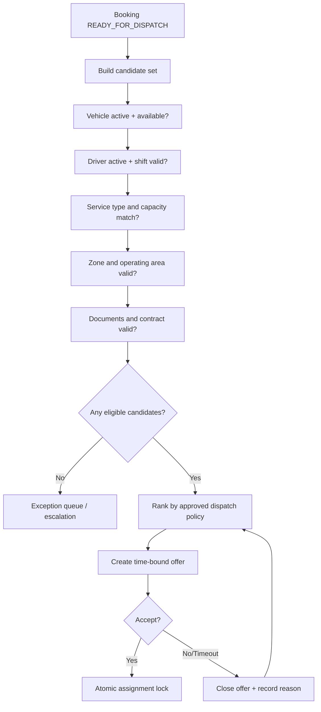
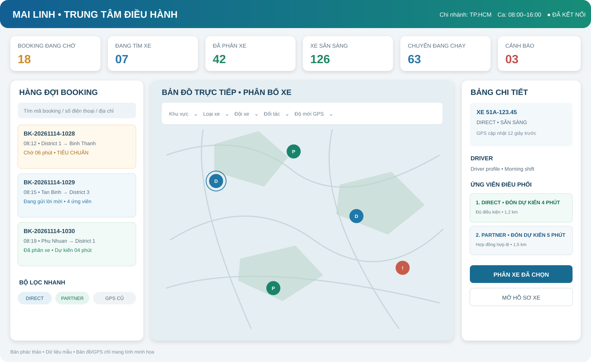

# 06 — ĐIỀU PHỐI VÀ TRUNG TÂM ĐIỀU HÀNH

## 1. Quy trình điều phối

## 2. Mandatory eligibility gates

1. Vehicle active and not blocked/maintenance.
2. Driver active and qualified.
3. Vehicle-driver association valid where required.
4. Shift/availability valid; no conflicting active trip.
5. Vehicle type/capacity matches requested service.
6. Inside permitted operating area or cross-zone rule.
7. Required documents are valid.
8. PARTNER contract is valid and permits this trip/service/zone.
9. No suspension, safety block or administrative restriction.

Every rejection returns a machine-readable reason.

## 3. Candidate ranking — configurable policy

Candidate dimensions may include route ETA, distance, idle time, utilization/fairness, service match, zone balance, driver response reliability and fleet economics. The business owner must approve weights, tie-breaks and fairness rules.

DIRECT/PARTNER priority is not assumed; it remains TBD.

## 4. Offer lifecycle

Offer contains offer_id, booking_id, vehicle_id, driver_id, issued_at, expires_at and policy_version. Driver actions are authenticated/idempotent. Server time controls expiry. Accept atomically checks conflicts and locks one active assignment. Reject/timeout closes offer and records reason.

## 5. Control Tower layout

- Header: branch/region/shift/user and global search.
- KPI strip: waiting, searching, assigned, available, active trips, incidents.
- Left queue: booking, SLA age, pickup time, service and dispatch state.
- Center map: vehicle markers, clusters, bookings, zones and legend.
- Right panel: selected booking or vehicle, candidates and allowed actions.
- Alert drawer: SOS, GPS stale, no candidate, overdue pickup and integration outages.

## 6. Map marker semantics

| Marker | Meaning |
|---|---|
| DIRECT vehicle | Distinguishable DIRECT symbol/tag |
| PARTNER vehicle | Distinguishable PARTNER symbol/tag |
| Available | Available state |
| Offered/reserved | Offer pending |
| To pickup | Driver en route |
| On trip | Trip active |
| GPS stale | Freshness overlay, not vehicle status |
| SOS | High severity and explicit label |

Clustering is mandatory at density. Display GPS accuracy/freshness and avoid claiming precision unsupported by source data.

## 7. Exception queue

| Code | Trigger | Suggested action |
|---|---|---|
| NO_CANDIDATE | No eligible vehicle | Expand allowed search / supervisor |
| OFFER_TIMEOUT | No driver response | Next candidate |
| DRIVER_REJECTED | Driver rejected | Next candidate and record reason |
| GPS_STALE | Location older than threshold | Contact driver/check network |
| PICKUP_OVERDUE | Pickup outside SLA | Escalate/customer update |
| CONTRACT_INVALID | Partner contract invalid | Block candidate |
| ASSIGNMENT_CONFLICT | Concurrent assignment | Refresh/resolve |
| DISPATCH_DEGRADED | Dispatch/map service unavailable | Manual contingency |

## 8. Manual dispatch

- Show candidate eligibility reason and ETA basis.
- Override ranking requires permission and reason.
- Maker-checker thresholds are TBD.
- Store candidate set, selected vehicle, ranking/policy version and override history.
