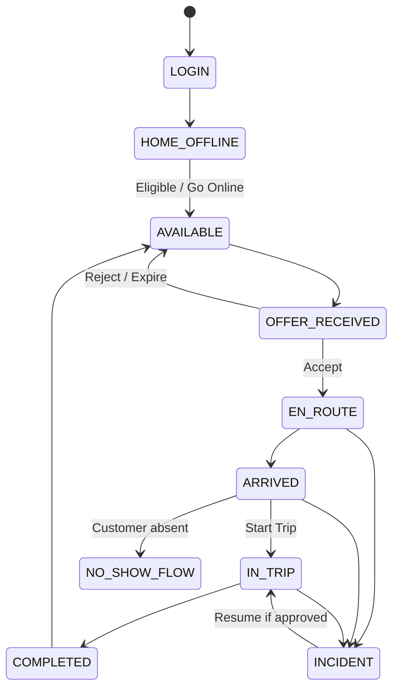

# 07 — ĐẶC TẢ ỨNG DỤNG TÀI XẾ

## 1. Hành trình của tài xế

## 2. Screen specifications

### D-01 Login
Authentication by IAM; session/device controls; no plaintext credential storage.

### D-02 Home / Availability
- Driver and current vehicle.
- Online/offline state.
- GPS permission, freshness and network.
- Pending sync count.
- Go Online only when eligibility passes.
- Show reason when eligibility fails.

### D-03 Offer
- Trip summary and pickup zone/address according to privacy rules.
- Service type, expiry countdown and ETA estimate if available.
- Accept/Reject.
- Expired offer disabled on device and rejected server-side.

### D-04 En route to pickup
- Navigation handoff.
- Pickup address/landmark.
- Contact customer action subject to masking/contact policy.
- Arrived action creates event with location if available.

### D-05 Arrived / Waiting
- Arrival timestamp and wait timer.
- Customer contact.
- Start Trip.
- No-show flow only after approved wait/cutoff rules.

### D-06 In Trip
- Destination and ordered stops.
- Navigation and accessible SOS.
- Complete Trip with confirmation.
- Minimize distraction and avoid complex forms while moving.

### D-07 Completed
- Server-generated fare summary.
- Payment method and amount collected.
- Cash collection is driver-confirmed and later reconciled.
- Electronic payment success comes from provider/backend, not driver assertion.

### D-08 Incident / SOS
- Accessible from every active trip screen.
- Send trip, driver, timestamp and location where available.
- Category and short note.
- Queue safely if offline; show Pending until acknowledged by server.

## 3. Offline behavior

- Store minimum required event payload locally.
- Event has client UUID, trip, type, device time and sequence.
- Backend deduplicates and validates current state.
- Client shows Pending / Synced / Rejected with reason.
- Never show success before server acknowledgement.
- No silent conflict resolution for safety/financial events.

## 4. Safety and usability

Large touch targets, limited steps, high contrast, minimal typing, GPS/background permission explanation, battery/network status. Driver device and OS minimum version are TBD.

## 5. Driver acceptance

Ineligible driver cannot go online; offer action is idempotent; expired offer rejected; invalid transition rejected; offline event sync reconciles; SOS appears in Control Tower with freshness metadata.
