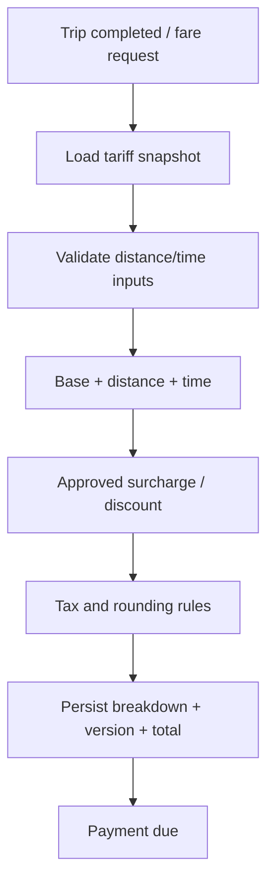
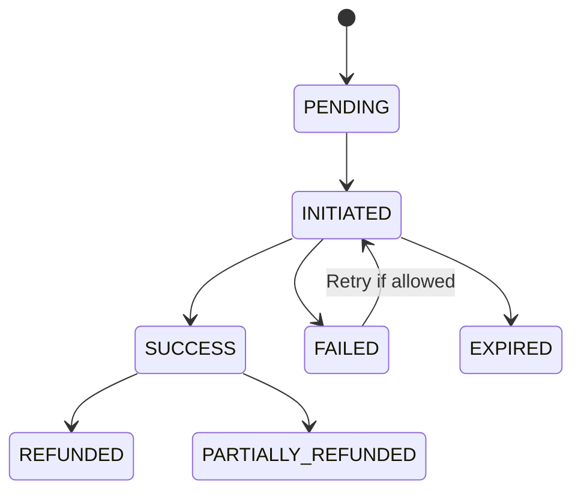

# 08 — TÍNH CƯỚC, THANH TOÁN VÀ ĐỐI SOÁT

## 1. Mô hình tính cước

A fare is reproducible and stores tariff_version_id, effective timestamp, distance/time inputs and source, base fare, distance component, time component, approved surcharges, discounts, taxes/rounding where applicable, total, currency, engine version and calculation timestamp.

**Rates, rounding, waiting, toll, airport/zone/night/stop fees and tax rules are TBD until Business/Finance approval.**

## 2. Payment lifecycle

Payment transaction is immutable; refund is a separate linked transaction. Validate provider signature, idempotency and replay. Reconcile provider success/local pending mismatches. Cash handling policy is TBD.

## 3. Ledger

Ledger records reference trip/payment/source event. Never overwrite posted entries; corrections are compensating entries. Account mappings, debit/credit treatment and statutory reporting must be approved by Finance. This document does not prescribe statutory accounting.

## 4. DIRECT/PARTNER economics

| Component | DIRECT | PARTNER |
|---|---|---|
| Gross fare | Fare record | Fare record |
| Revenue allocation | Internal policy | Contract policy |
| Partner share | Not applicable by default | Contract-derived |
| Deduction | Internal policy | Contract terms |
| Net payable | Internal process if applicable | Partner settlement |
| Audit | Required | Required |

## 5. Partner settlement

Batch keys: partner_id, contract_id/policy version, period, branch/region if needed, currency.

Line fields: trip_id, completed_at, gross fare, eligible deductions, partner share, adjustment, net payable/receivable, calculation reference.

Workflow: Draft → Calculated → Reviewed → Approved → Locked → Paid.

## 6. Settlement controls

- Do not include the same trip twice in one settlement basis unless explicit adjustment policy permits.
- Validate contract effective period against approved business rule.
- Keep disputed lines visible with owner/status.
- Lock requires privileged role and audit.
- Post-lock correction uses linked adjustment batch.
- Export includes batch ID, version, generated timestamp and filters.

## 7. Reconciliation

1. Completed trips ↔ fare records.
2. Fare records ↔ payment transactions.
3. Provider statement ↔ internal payment records.
4. Ledger ↔ trip/payment references.
5. PARTNER settlement lines ↔ contract snapshot.
6. Settlement batch ↔ payout evidence.

Variance categories and tolerance levels are TBD.
