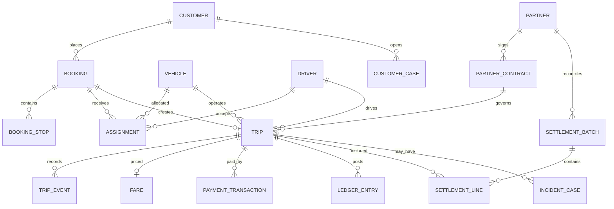

# 09 — MÔ HÌNH DỮ LIỆU VÀ SƠ ĐỒ ERD

## 1. Nguyên tắc mô hình hóa dữ liệu

Separate master data, operational transactions, events and financial ledger. Preserve tariff/contract snapshots. Use immutable IDs, UTC timestamps, explicit PII classification and geospatial coordinates with agreed SRID.

## 2. Logical ERD

## 3. Entity dictionary

| Entity | Key fields | Notes |
|---|---|---|
| Customer | customer_id, phone, name, type, consent | PII |
| Booking | booking_id, channel, customer_id, pickup, destination, scheduled_at, status | Channel ≠ fleet type |
| BookingStop | stop_id, booking_id, sequence, location, type | Multi-stop |
| Vehicle | vehicle_id, plate, vehicle_type, fleet_type, owner_id, status | DIRECT/PARTNER |
| Driver | driver_id, status, license_valid_to, organization_id | Restricted data |
| Partner | partner_id, legal_name, status | Master |
| PartnerContract | contract_id, partner_id, valid_from/to, policy_version | Effective dating |
| Assignment | assignment_id, booking_id, vehicle_id, driver_id, offer_status, timestamps | Offer history |
| Trip | trip_id, booking_id, vehicle_id, driver_id, fleet_type, status | Policy snapshot |
| TripEvent | event_id, trip_id, event_type, server_at, device_at, actor_id, payload | Append-only |
| Fare | fare_id, trip_id, tariff_version_id, components, total | Snapshot |
| PaymentTransaction | payment_id, trip_id, method, amount, status, provider_ref, idempotency_key | No raw card data |
| LedgerEntry | ledger_entry_id, trip_id, account_code, debit, credit, source_ref | Append-only |
| SettlementBatch | batch_id, partner_id, contract_id, period, status, totals, locked_at | Lockable |
| SettlementLine | line_id, batch_id, trip_id, gross, deductions, share, net | Drill-down |
| IncidentCase | incident_id, trip_id, category, severity, status, owner_id | Operations/CS |

## 4. Mandatory constraints

- Unique booking/trip/assignment identifiers and payment provider reference/idempotency key.
- Maximum one active assignment per booking.
- No overlapping active trip for same vehicle/driver unless policy explicitly permits.
- Referential integrity from settlement line to trip and partner/contract.
- Trip fleet_type immutable after dispatch lock except controlled correction event.
- Tariff/contract versions remain addressable after expiry.
- No destructive changes to posted ledger or locked settlement.

## 5. Indexing candidates

Booking status + created_at; scheduled_at + status; assignment booking_id + active flag; vehicle_id + last_location_received_at; trip status + timestamps; partner_id + settlement period; provider_ref + payment status; trip_event trip_id + server_at.

Partitioning, GPS retention and analytics replication depend on volume/legal policy (TBD).

## 6. Data migration

Inventory source systems; profile data; define mapping; resolve duplicate customers/vehicles/drivers; normalize phones/plates/timezones; map DIRECT/PARTNER and contract validity; dry run; reconcile counts/balances; final delta migration; business sign-off; retain rollback snapshot.
