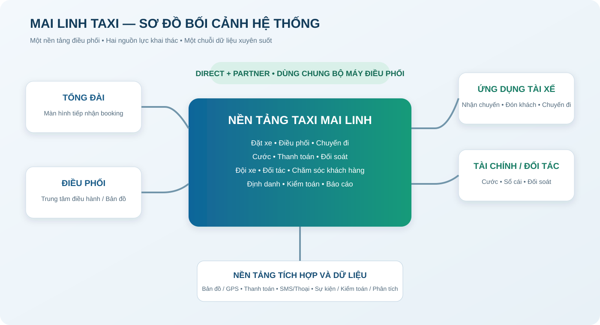
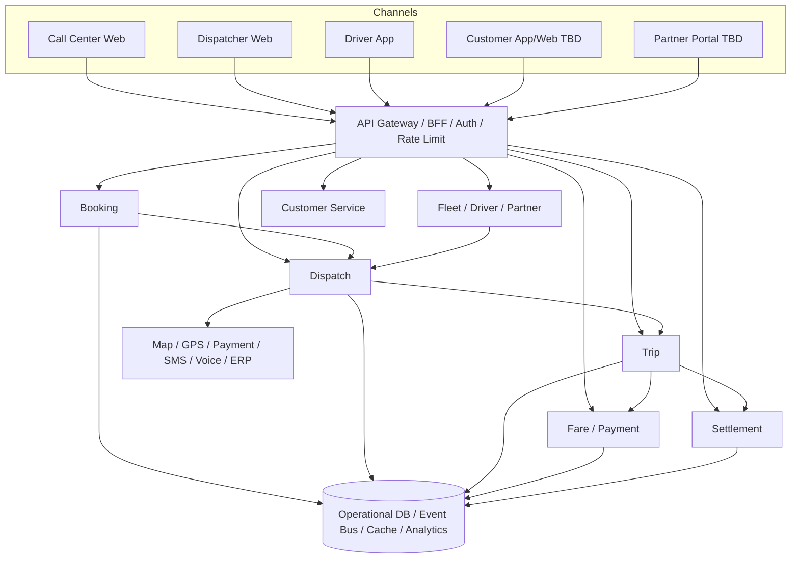

# 11 — KIẾN TRÚC, YÊU CẦU PHI CHỨC NĂNG VÀ BẢO MẬT

## 1. Kiến trúc logic

## 2. Deployment architecture — decision required

Evaluate:
- Modular monolith with strict domain boundaries for initial delivery.
- Split domain services when scale/ownership/operational maturity justify it.
- Separate GPS ingestion/realtime workload from transactional APIs.
- Queue/event bus for asynchronous integration and notification.
- Read replicas/analytics store for reporting.

Final hosting (cloud/on-prem), HA topology, sizing, technology and network zones require IT approval.

## 3. NFR catalogue

| ID | Area | Requirement | Target |
|---|---|---|---|
| NFR-001 | Availability | Availability by critical service | TBD |
| NFR-002 | Latency | p95 booking/dispatch/API | TBD |
| NFR-003 | Realtime | GPS freshness/map refresh | TBD |
| NFR-004 | Scale | Fleet, booking peak, concurrency, GPS events/sec | TBD |
| NFR-005 | Resilience | Retry, DLQ, circuit breaker, idempotency | MUST |
| NFR-006 | Observability | Logs, metrics, tracing, alert, correlation ID | MUST |
| NFR-007 | Backup | Encryption, retention, restore verification | MUST |
| NFR-008 | DR | RPO/RTO, DR site | TBD |
| NFR-009 | Compatibility | Browser and mobile OS baseline | TBD |
| NFR-010 | Localization | Vietnamese, VND, branch timezone | MUST |
| NFR-011 | Integrity | Trip and ledger traceability | MUST |
| NFR-012 | Accessibility | Contrast, text/icon, touch target | SHOULD |

## 4. Security

- RBAC plus scope authorization at API layer.
- MFA for privileged roles where required.
- TLS in transit; encryption at rest for sensitive data.
- Secrets outside source control.
- PII masking in UI, logs and exports.
- Session expiry and device/token revocation.
- Rate limiting and abuse protection.
- Webhook signature validation/replay prevention.
- Audit fare, payment, contract, settlement, permission and dispatch overrides.
- Security test aligned with OWASP application risks.

## 5. Privacy

For every data category define purpose, lawful basis/consent where required, role access, retention, export, anonymization/deletion and breach response. Legal/Privacy and IT must approve.

## 6. Observability dashboards

API p95/errors; queue lag/DLQ; booking backlog; dispatch time and offer acceptance; GPS freshness; driver sync pending; webhook failure/reconciliation; settlement failures; DB health/storage; backup/restore.

## 7. Architecture Decision Records

Create ADR for application topology, database/spatial support, event platform, realtime protocol, map/GPS provider, identity/SSO, payment gateway, hosting/HA, backup/DR.
